<!--
HOW TO ADD A NEW ENTRY (for the next big update):
Copy the block below to the TOP of the list (newest first) and fill it in.

## [vX.Y.Z](https://github.com/knightinfected/PipeWireController/releases/tag/vX.Y.Z) — YYYY-MM-DD
**One-line headline of the release**
- Highlight one
- Highlight two


Screenshots: take them, save as kebab-case PNGs in `screenshots/`, then add the
`` line. Leave a placeholder note (like the
0.3.2 entry) until the image exists so the page never shows a broken image.
-->

# Changelog — release highlights

The bigger updates, newest first, with screenshots. This is a curated
highlights reel, not an exhaustive log — for the complete history see the
[GitHub releases](https://github.com/knightinfected/PipeWireController/releases)
and commit log.

---

## Unreleased

**The Devices page, redesigned**

Every output and input is now a card that shows what the device is doing,
not just how loud it is.

- **Where the sound is.** A card names the port (Speakers, Headphones) and
  how the device is connected: Built-in, USB, HDMI, or Bluetooth with its
  codec. Switch ports with one click; an unplugged one is greyed out.
- **What's playing.** Every app playing through a device shows on its card.
  Click an app to move it to another device, or drag it onto that device's
  card. An app recording what a device plays shows there too.
- **Where a virtual device sends its sound**, and which ones send into a
  device, so a chain of devices can be followed at a glance. You can change
  where a virtual device sends from its card.
- **The sound card's profile**, with a warning and a one-click fix when the
  profile gives no sound, such as HDMI with nothing plugged in. A sound card
  that is switched off keeps a card of its own with the way to turn it back
  on, so it never just disappears from the page. On a Bluetooth headset,
  that's also where you turn its microphone on.
- **Whether it's running, and its format**, under the device's name: the
  sample rate and bit depth while it plays, and its channel layout (Stereo,
  5.1, 7.1).
- **Fold what you don't need.** A card folds down to its name and volume,
  and a heading folds its whole section (all the outputs, say). The page
  remembers what you folded.
- **Test** plays a short chime on an output, left then right.
- **Settings** for a hardware device (its name, hiding it, sample rate,
  buffering, when it suspends) open from the gear beside its name, in their
  own window, grouped by what they're for, with a way to reset them. Hover
  a setting to see what it does.
- The default output and input are ringed, and a filter finds a device by
  name.

**Balance, and a volume for each channel**

Every output, input and app in the Mixer has a **Channels** button next to
its volume. It opens a **Balance** slider for anything in stereo, and a
slider for each channel: front left, front right, centre, subwoofer and so
on, or AUX 0 to AUX 7 on a Pro Audio card. Use it to even out speakers that
sit at different distances, turn down one side of a pair of headphones, or
set two outputs of an audio interface to different levels. **Reset** puts
every channel back to the same level. The Devices page has the same controls
under each card's Channels button. A pair of AUX channels gets two sliders and no
Balance, because on a Pro Audio card they are often two separate outputs.

- **Every other volume slider keeps your balance.** The main slider in the
  Mixer, the Overview's default-output card, Favourites, the Equalizer and
  Signal Paths all move every channel by the same amount, and so do Device
  Presets and routing snapshots, which store one level.
- **It's still there after a restart.** WirePlumber saves the balance and
  puts it back when the device or app returns, for hardware, for the app's
  own virtual devices, filter chains and equalizers, and for apps.
- **A balanced device's slider shows its loudest channel**, as pavucontrol
  and GNOME do. It used to show the left channel. Nothing changes for a
  device whose channels are all at the same level.
- Each channel slider follows the volume style you picked in the header.

**Bug: moving a volume slider undid a balance set somewhere else**

If you had set a balance in pavucontrol or your desktop's sound settings,
touching any volume slider in this app set every channel to the same level,
and the balance was gone. Every slider now scales the channels together and
keeps the balance (above).

**The app starts listening instead of asking every few seconds**

Until now, every page that shows live audio state kept itself current by
asking again on a timer. It re-read the whole audio graph every three
seconds, and asked systemd about each audio service every five, whether or
not anything had changed. So a change made somewhere else (your headphones'
buttons, the desktop's volume widget, another app, a device plugged in) took
up to three seconds to show. And the app kept starting small processes the
whole time it was open, nearly all of them to learn that nothing had
happened.

This release starts replacing those timers with listeners. The app hears
about a change when it happens, and does almost nothing in between. On the
Devices page with nothing happening, it used to start 76 processes a minute,
and now starts 2. Its share of the CPU there, counting the work PipeWire does
on its behalf, went from about 5.4 % of a core to about 2.4 %. Most of what's
left is the level meters.

- **Devices** listens to PipeWire. A change shows within about a tenth of a
  second instead of up to three seconds. The page reads the graph again only
  when something changes, plus once every 30 seconds as a safety check, and
  dragging a slider makes it re-read at most twice a second.
- **Service status** is read from systemd directly, without starting a
  process, and a failure arrives as systemd's own notification. See "A failed
  audio service is noticed at once" below.
- **Default devices and clock settings** are read from the snapshot of the
  graph each page already takes. See "Fewer processes on every refresh" below.

Also worth knowing:

- **Restarting the audio services is handled.** The listeners go away with
  PipeWire and come back with it, and the page waits until the devices are
  back before it redraws, so it doesn't flash a half-empty list. After a
  restart of PipeWire, PipeWire-Pulse and WirePlumber together, the page
  showed every device again in under a second.
- **It works the same on PipeWire 1.0**, which reports a default-device
  change differently, through a channel that falls silent once WirePlumber
  restarts on its own. The app notices and reconnects, so a new default
  still shows at once there.
- **Two small background processes** run while a page that listens is open:
  `pw-dump` and `pw-metadata`, named `pwctl-livestate-graph` and
  `pwctl-livestate-meta` in a process list. They stop when you leave the page
  or close the app. If the app crashes, its next start cleans them up, as it
  already did for the level meters.
- **If the app can't listen**, for example because `pw-dump` is missing, the
  page checks every three seconds, as before.
- **For now this is the Devices page.** The Dashboard, Signal Paths and the
  Patchbay still re-read every three seconds, and move over next. The Monitor
  keeps its timer on purpose, because its graphs sample at a steady rate.

**Bug: the Devices page did not follow changes made outside it**

Turn the volume down with your headphones' buttons, the desktop's volume
widget or another app, and the Devices page kept showing the old level until
you went to another page and back. Mute and the default-device star went stale
the same way. The page read the audio graph once, when you opened it, and never
again.

It now follows the audio graph while it is on screen, and a change shows within
about a tenth of a second (how, in the entry above). It moves the controls
that are already there instead of redrawing the page — so a device you have
expanded stays expanded, a slider you are dragging is not pulled back, and the
level meters keep running. Making a device the default no longer folds up the
one you had open, either.

Thanks to @iibaranov-IG for the fix (#20), and to @The-M1k3y for the report
(#19).

**Bug: a new default device took a while to show on the Dashboard**

Making a device the default, with the star in the Mixer or from the Default
output and Default input cards, now shows at the click. The star and the card
used to wait until the page next read the audio graph: half a second at
best, and up to three seconds when that read was skipped because the page
was already busy reading. If the switch fails, the page now says so and puts
the star back. It used to report success either way.

That skipped read affected more than the default. On the Dashboard, Signal
Paths and the Patchbay, a refresh asked for while the page was busy was
dropped and waited for the next three-second poll. It now runs as soon as the
busy one finishes, so a stream you move or a cable you patch no longer
sometimes takes seconds to show. The Dashboard also takes its first look
120 ms after an action instead of 500 ms.

**Bug: after a sound card changed profile, its volume showed as 100%**

Switch a sound card, such as your computer's built-in audio, to another
profile and back (Pro Audio, Off, output only, or any other), and the app
showed that card's speakers and microphone at 100% and unmuted, whatever
they were really set to. `wpctl`, `pactl` and your desktop's volume control
still showed the real level. But the first drag of the slider started from
100%, so it could make the sound louder than it was, and a muted card could
look unmuted. This had been the case since v0.6.0.

The app now reads a sound card's volume and mute from the card itself, the
way `wpctl` does. Bluetooth, virtual devices and Pro Audio weren't
affected. A device preset or routing snapshot saved while a card was in this
state stored 100% for it: save it again to store the real level.

**Bug: in a narrow window, the page's name covered the Overview and Mixer
buttons**

Make the window narrow enough and the name of the page you were on was drawn
on top of the Overview and Mixer buttons at the top of the window, so you
could read neither. This had been the case since v0.6.0. Now, once the top
bar is too narrow for its labels, Overview, Mixer, the volume style button
and Device Presets show just their icons, and each name moves into the
button's tooltip. The style button's tooltip always names the style you're
using. The point where the labels go depends on your font size and on the
style's name, because the app measures the labels rather than assuming a
width. In a wider window nothing changes.

**Bug: in a narrow window the app drew under the windows beside it**

The window couldn't be made narrower than about 810 pixels on any page,
because every page was given the room the widest one needed. When a tiling
desktop gave it less than that (half of a 1440-pixel screen, say), the app
drew past the edge of its own window and under the windows next to it. Now the
window takes whatever width it's given, down to 360 pixels, and nothing is
drawn outside it.

- **Below about 840 pixels the sidebar slides over the page** instead of
  sitting beside it, so the page gets the whole window. The new button at the
  top left opens it, and it closes again when you pick a page, click outside
  it, or press Escape.
- **The same button hides the sidebar in a wide window too**, and the app
  remembers whether you left it shown.
- **Up and Down in the sidebar still change pages.**
- **Some pages still need more than 360 pixels**: the Patchbay, Monitor,
  Surround Setup, the Dashboard, Devices, the HRIR Library and Filter Chains.
  In a window narrower than that page, its right side is cut off at the
  window's edge. Making each of them fit is the next job.

The sidebar and the narrow-window handling come from
[lonk42](https://github.com/lonk42)'s pull request
[#18](https://github.com/knightinfected/PipeWireController/pull/18).

**Bug: some messages at the bottom of the window showed up empty**

A message popping up at the bottom of the window showed as an empty box
with only its ✕ whenever its text had a `&` or a `<` in it. That happened
with any device, filter chain or equalizer whose name has an `&` (such as
"Game & Chat"), and with error messages from PipeWire or systemd, which
often contain a `<`. So some failures went unexplained. This had been the
case since v0.3.0. Messages now show their text exactly as written.

**Turning a virtual device on or off no longer pops up a message**

The switch already shows it. If starting or stopping the device fails, a
message still says so, with the reason.

**Bug: the Surround speaker test could play on the wrong speakers**

In Surround Setup, testing a speaker played the tone on your default output
instead of the sound card you picked whenever that card had appeared after
you logged in: one plugged in later, or one whose profile you had switched.
With no card picked, the tone could also follow wherever PipeWire last
remembered sending it. It now plays on the card you picked, or on your
default output when you haven't picked one. This had been the case since
v0.1.0.

**Bug: Monitor's node list jumped back to the top on every refresh**

The Node activity (pw-top) list on the Monitor page went back to its first
line every time it refreshed, every 1 to 5 seconds depending on your
setting. So you couldn't read the end of a long list, or select text long
enough to copy it. It now stays where you scrolled it. Reported in
[#16](https://github.com/knightinfected/PipeWireController/issues/16).

**Bug: the Dashboard said PipeWire-Pulse was not running after every
login**

PipeWire-Pulse starts by itself when the first app that needs it connects.
Until then the Dashboard said "PipeWire-Pulse is not running — audio will
not work", which wasn't true. The Dashboard and Monitor now show it as
"on demand", and the Dashboard says audio is running. If it fails, the
warning still appears. This had been the case since v0.6.0.

**Bug: Signal Paths' equalizer said its bands change while audio plays**

The equalizer stage's settings said its bands' frequency, gain and Q could
be changed while audio is playing. They can't: saving rebuilds the strip,
which stops its sound for a moment. The text now says so.

**Fewer processes on every refresh**

To find out which devices are the defaults, every page that lists devices
started a separate `pw-metadata` process each time it refreshed, and the
Dashboard started a second one for the clock settings. Both answers were
already in the snapshot of the audio graph the page had just taken, and are
now read from there. A Dashboard refresh starts two fewer processes, and
Devices and Signal Paths one fewer, each about 8 ms of CPU.

**A failed audio service is noticed at once**

To notice PipeWire, WirePlumber or PipeWire-Pulse failing, the app asked
systemd about all three every five seconds, on every page: three processes
each time. It now listens to systemd instead, so the notification comes
within a fraction of a second. A service that fails and is started again
between two checks is no longer missed either. On the Dashboard, the
service status and the "not running" warning now change as the service does.
After a restart from the Dashboard they used to take up to 12 seconds.
Every other place that shows whether a service or chain is running also
reads it without starting `systemctl`. Where systemd is not on the session
bus, the old checks still run.

**Bug: the "needs a newer libadwaita" message pointed at releases that don't
start either**

On a system with libadwaita older than 1.7, such as Ubuntu 24.04 LTS or
Linux Mint 22, the app explains why it can't start. That message said
releases before v0.6.0 would still start there, with only Signal Paths
missing. They don't: from v0.4.0 on, Signal Paths is built when the window
opens, and none of those releases open a window at all on libadwaita 1.5.
The message now names v0.3.6, the last release that runs on libadwaita 1.5
or 1.6, and on anything older it no longer suggests a release.

**Bug: a name with a tab or line break in it stopped the device from
starting**

Config files are written in PipeWire's own format, and the app's reader and
writer for it didn't follow PipeWire's rules in a few places:

- **A name with a tab or line break** (easy to paste into a name field) was
  written into the config as it was. PipeWire refuses a config like that
  entirely, so the filter chain, virtual device or equalizer never started,
  even though the app's own check before saving passed it. Such characters
  are now written in the escaped form PipeWire reads back.
- **Importing a config** that writes a character as an escape, such as
  `\u00e9` for "é", showed and kept a garbled name. One with a `\n` escape
  was turned into a config PipeWire refuses. Both now come through as
  PipeWire reads them.
- **Numbers keep the exact text they were written with** when an imported
  config is saved again. Before, `1_000` came back as `1000`, which PipeWire
  can read differently. Numbers are also read the way PipeWire's config
  reader reads them: `0x10` is 16 rather than text, and `inf` and `nan` are
  words rather than numbers.
- **Swapping the HRIR file of an imported chain** to a file whose path holds
  a `"` or a `\` gave PipeWire a cut-off file name, or a config it refused.
  The path is now written so PipeWire reads it back whole.

**Configs PipeWire would refuse are caught before they're used**

The app's check of a config now refuses what PipeWire refuses: an unknown
escape such as `\x`, a raw tab or line break inside quotes, or an accented
letter or backslash outside quotes. PipeWire skips a file like that
entirely. Before, the app accepted it and the filter chain or device then
failed without saying why. Now:

- **The raw config editor** says what is wrong and on which line, and
  doesn't save.
- **Importing** shows such a file greyed out with the reason, and choosing
  one from a file says why it can't be imported.
- **The Settings pages** no longer show values from a drop-in PipeWire
  skips.
- **Configs you already have keep working.** An imported chain that only ran
  because the app rewrote it still gets rewritten the same way, and the
  app's own settings files are read as before and written back in the form
  PipeWire accepts.

## [v0.6.1](https://github.com/knightinfected/PipeWireController/releases/tag/v0.6.1) — 2026-10-08
**A `.deb` for Debian 13 and Ubuntu 26.04, channel maps for any device, and fixes for virtual surround that came out far too loud and filter chains that would not start**

**A `.deb` for Debian 13 and Ubuntu 26.04**

Debian and Ubuntu users no longer need a git checkout. Each release now comes
with a `.deb` attached:

```bash
sudo apt install ./pipewire-control-center_0.6.1_all.deb
```

apt pulls in everything the app needs, including the cairo bridge its meters
draw with. It installs the same files in the same places as the AUR package:
the app under `/usr/share/pipewire-control-center/`, the
`pipewire-control-center` and `pwcc` commands, and an app-menu entry.
`apt remove` takes it all off again, and neither touches your chains or
settings in `~/.config`. There's no apt repository, so it doesn't update
itself. Install the next release's `.deb` the same way.

It needs libadwaita 1.7, so it's for Debian 13 and Ubuntu 26.04 LTS or newer.
On Ubuntu 24.04, apt refuses it and names the libadwaita version it needs,
rather than installing an app that can't start.

**Virtual surround no longer comes out far too loud**

The virtual surround templates mix eight convolvers into each ear, and HRIR
files aren't normalised, so even one of them can come out louder than what
went in. At the default gain of 1.0, every HeSuVi file we measured came out 5
to 19 dB over full scale, so it distorted. The *Convolver gain* box could always fix that, but
it started at 1.0 and nothing said it needed changing. PipeWire's own
example config has the same gap.

The right gain depends on the file (from about 0.12 to 0.55 across a whole
HeSuVi collection), so the app now works it out from the file itself:

- **New chains get the right gain automatically**, whether you make them in
  the chain dialog or with the HRIR library's *New chain* button. The value
  is saved with the chain, so it stays where it was put.
- **The chain dialog has a Level section.** It shows where the chain peaks
  against full scale on a bar that moves as you change the gain, and has a
  button that applies the suggested gain.
- **Chains you already have keep their gain.** Nothing about how they
  sound changes on its own, but a chain that is too loud now shows a
  *Too loud* tag in the list. Imported configs are measured as written, and
  the dialog says what to change in their text.

The same measurement covers the stereo and true-stereo convolver templates.
The *Convolver gain* box now only appears for templates that have a
convolver.

**Channel maps now work with any device, not just Pro Audio cards**

You could already build a virtual device wired to *specific channels* of a
real one — but only if that device was a sound card in the "Pro Audio"
profile, showing raw `AUX0`, `AUX1`… channels. Every other multi-channel
device was refused, even though the mechanism handles them perfectly.

It no longer is. Pick any output or input, and map each channel of a virtual
device onto a channel of it:

- **A controller whose rear channels are its haptics.** A DualSense is a
  four-channel audio device: the front pair is the speaker, the rear pair is
  the haptics. Map a stereo sink onto just those two and you have an ordinary
  output — with its own volume, and an equalizer or filter chain in front of
  it if you want one — that reaches nothing but the haptics.
- **One pair of a surround card.** Send something to just the rear speakers,
  or just the centre, without touching the rest.
- **Chosen inputs of an interface** published as a virtual microphone.

Audio goes straight through, channel for channel — nothing is up- or
downmixed, and the channels you leave out receive nothing at all.

Devices you already had are untouched: existing Pro Audio maps generate
exactly the same configuration as before and keep being linked the same way.
Only the wording changed — the dialog now says **Channel map**, and the note
about Pro Audio needing manual linking appears only when you actually pick a
Pro Audio device.

**Filter chains no longer fail with an error that explains nothing**

On distributions that split PipeWire's plugin support into separate packages,
adding a plugin to a Signal Path or an effect rack could produce a chain that
simply refused to start — and the only explanation offered was systemd's
"control process exited with error code", which names neither the cause nor
the cure. Arch ships every piece in one package, so this was invisible here
and reported from elsewhere.

The app now establishes what this machine can actually load, before it starts
anything:

- **Plugins PipeWire cannot host here are greyed out in both pickers**, with
  the reason on the row and the package to install where that is known.
- **A chain that would fail is refused up front**, naming the missing piece
  instead of leaving you in `journalctl`. Every surface that builds a chain is
  covered, including the surround templates, the noise suppressor and
  microphone cleanup.
- **Plugins the app cannot wire are refused too.** Anything that is neither
  mono nor stereo used to be offered and accepted, then run with its ports
  dangling — no error anywhere, just wrong audio. That one was not
  distro-specific; it had been hiding behind the louder failure.

Also fixes the bundled noise suppressor's plugin path on distributions that
keep 64-bit plugins in `/usr/lib64`.

This matters most on **Ubuntu 26.04**. It keeps PipeWire's LV2, SOFA and
loudness support in a separate package, `libspa-0.2-modules-extra`, which
installing PipeWire doesn't pull in, so an LV2 effect there stopped its chain
from starting. Those plugins are now greyed out with that package named, and
the `.deb` installs it for you. The package the app names is the one your
distribution actually uses: Fedora's names on Fedora, Ubuntu's on Ubuntu and
the distributions built on it, and a plain description everywhere else.

**The Debian and Ubuntu install line was missing a package**

The level meters, graphs and Patchbay are drawn with cairo, and on Debian and
Ubuntu the piece that connects cairo to the app is a package of its own,
`python3-gi-cairo`. The install line left it out. If nothing else had
installed cairo's Python support first, the app wouldn't start. If something
had, the app opened, but the meters stayed flat and the Patchbay stayed empty.
The package is in the install line now, and the app checks for it when it
starts. If it's missing, the app says which package to install instead of
failing quietly.

Also, the app-menu entry for a git checkout now has the program's full path
written into it, so it launches even when the desktop's `PATH` doesn't include
`~/.local/bin` yet.

**The Fedora install line was missing two packages**

On Fedora 44, a git checkout installed with the README's `dnf` line didn't
start: GTK needs a typelib from `gobject-introspection`, which `python3-gobject`
no longer pulls in there. The line also left out `pipewire-utils`, which holds
`pw-dump` and the other PipeWire tools the app runs. Both are in the line now.

---

## [v0.6.0](https://github.com/knightinfected/PipeWireController/releases/tag/v0.6.0) — 2026-08-26
**The dashboard is rebuilt — two views instead of five tabs, pinned favourites, and the app now ships its own icons**

**libadwaita 1.7 is now the minimum**

The stated requirement was 1.4, and it had been wrong for some time — Signal
Paths has needed 1.7 since v0.4.0. The dashboard rebuild made it matter: the
view switcher in the window header is built before any page is, so on an older
libadwaita the app no longer starts at all rather than losing one page.

This drops **Ubuntu 24.04 LTS** (libadwaita 1.5.0), which was previously
listed as supported. Debian 13 (1.7.6) and Ubuntu 26.04 LTS (1.9.1) are the
floor; Fedora 42+, openSUSE Tumbleweed and Arch are all well above it. On
24.04 the options are 26.04, a backport, or running from a checkout against a
newer libadwaita.

Where libadwaita is too old, the app now **says so**: a window naming the
version it found and the version it needs, and the same text in the terminal.
Before this it crashed somewhere inside a widget, which showed nothing at all
when it had been started from its desktop entry.

**The dashboard is two views instead of five tabs**

Overview and Mixer, picked from a switcher in the window header rather than
from inside the page. The switcher stays in the header on every page, so the
dashboard is one click away from wherever you are.

Overview leads with your default output and default input, and a new
**Favourites** card: pin any output or input, hardware or virtual, and its
volume, mute and live meter stay on the dashboard. A favourite whose device is
unplugged keeps its place and still reads as its own name rather than
vanishing or turning into an ALSA device string, and its controls come back on
their own when the device does.

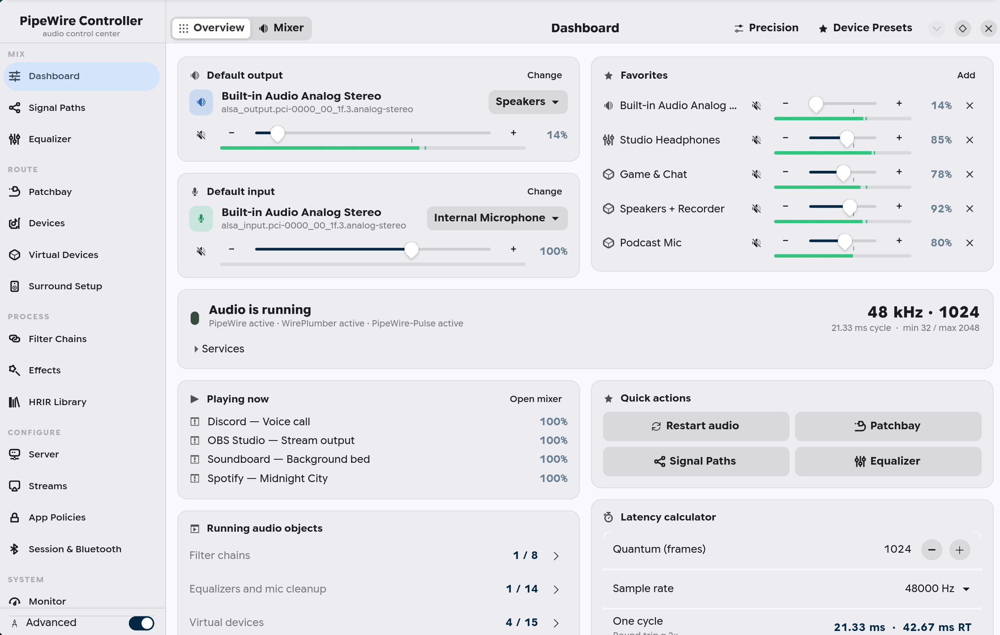

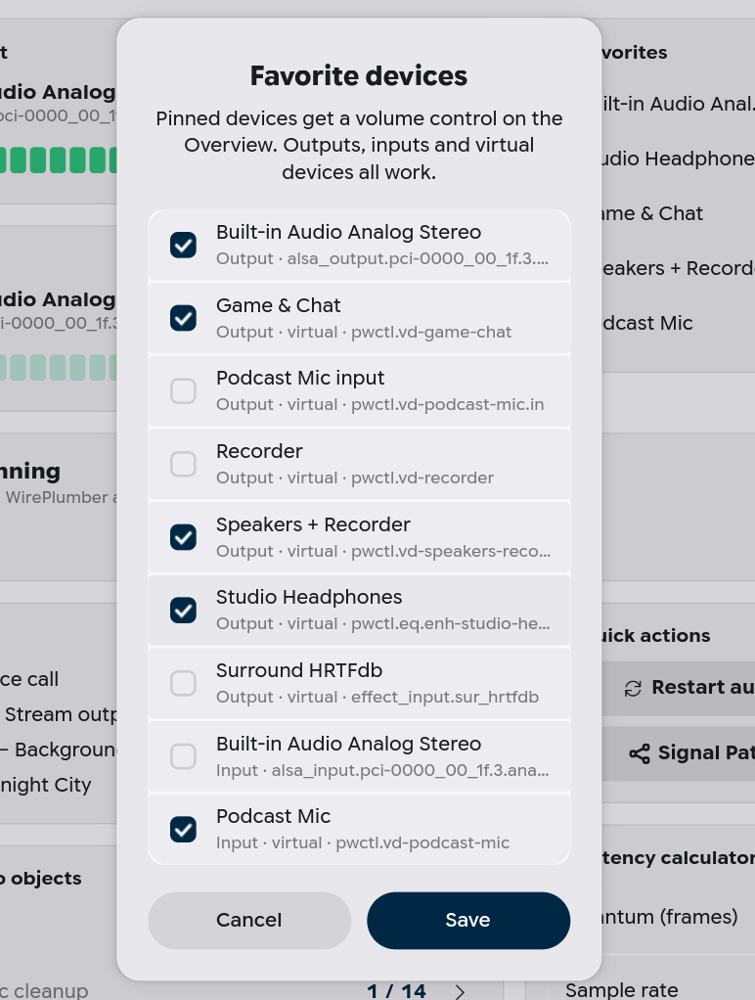

The sidebar's sixteen pages are now grouped under Mix, Route, Process,
Configure and System. Nothing was dropped in the rebuild: all sixteen pages
are still there, and so are the solo buttons, the card configuration row with
its warning and Reset, the port and profile dropdowns, the default star and
the latency calculator with its live Test.

The volume-style picker moved out of a floating panel over the dashboard and
into the header bar next to Device Presets. It changes the sliders on Devices,
the Equalizer and Signal Paths too, so it was never really a dashboard
setting.

**The top of the window reads as one band**

The sidebar header and the content header sit side by side, so the lines under
them should look like a single line across the window. They did not: they were
six pixels apart and two different colours, in the one place your eye is most
likely to follow a horizontal.

They meet now, and both are drawn by the same mechanism, so they match in
colour as well as in position. The band is a little taller, and the extra room
is spent above the view switcher rather than shared around it — centred in a
taller bar, the switcher floats with nothing to sit against. The page title is
now the same size as the app title, too: it names the whole page, and it was
the smallest text in a row that also held the app name and two bold buttons.

**Every page uses the width you give it**

Pages painted one column of about 730px however wide the window was. A wider
window now opens another column instead, so maximizing shows you more rather
than the same amount with more space around it.

**The dashboard refreshes about six times faster**

It was asking PipeWire for each endpoint's volume one command at a time, when
the level was already there in the reply it had just been given. A refresh
with 16 endpoints measured 463 ms before and 79 ms after.

**The app brings its own icons**

Icons used to come entirely from whatever icon theme you run, and that turned
out not to be safe. On Breeze nine of them did not exist at all and rendered as
a red "no entry" box — Signal Paths and Session & Bluetooth in the sidebar, and
the marker on every virtual device in the Mixer. One of them,
`utilities-system-monitor`, exists in neither Adwaita nor Breeze, so the Monitor
page was broken for everybody on every distro. Three more rows — Equalizer,
Streams and HRIR Library — all shared the same music note, because it was the
closest thing either theme had.

The icons for the things this app is actually about — routing, filters,
equalizers, virtual devices, meters — now ship with it, so they look the same
whatever desktop you are on and cannot disappear when a theme drops a name.
Ordinary actions like add, delete, refresh and open are deliberately left
alone: those still come from your theme and should follow it.

The sidebar has sixteen distinct icons now instead of thirteen, two of which
were red boxes.

Icons are from the GNOME icon-development-kit, which is public domain.

**A device row now says what kind of software device it is**

The Mixer already marked anything that was not real hardware with a small
**virtual** tag. It now adds a second one naming what the thing actually is —
**filter chain**, **signal path**, **equalizer**, **mic cleanup** or
**loopback** — and gives each kind its own icon, so a glance is enough.

This works for things this app did not create. A filter chain you wrote by
hand in `filter-chain.conf.d` has no settings page here, so the Mixer is the
only place it is named at all; it now reads *virtual · filter chain* rather
than just *virtual*.

Your own virtual devices still show a single **virtual** tag, because a second
one reading "virtual device" would only say the same thing twice.

The Devices page gets the same treatment, and the icon for a given device is
now the same wherever it is listed — Mixer, Devices and Favourites.

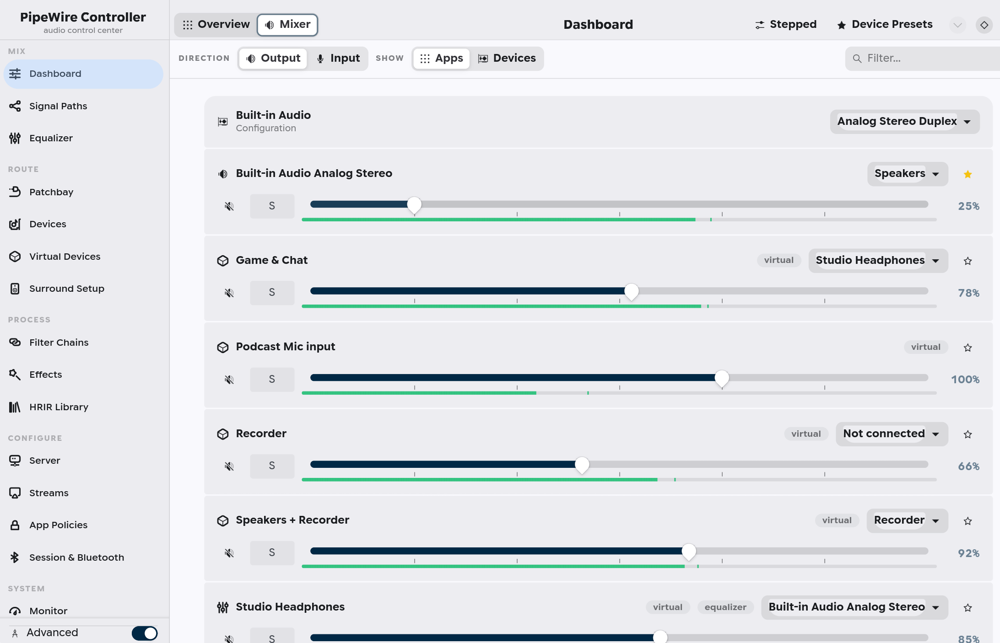

**Bug: a virtual device could not be re-pointed from the Mixer**

An equalizer, a filter chain or a virtual device showed up in the Mixer's
Devices list with a volume, a mute and a solo — and no way at all to say where
its audio should go. The only routing control that row ever had was the
hardware **Port** selector, and a virtual device has no ports, so it was always
hidden. Sending an app to a virtual device was a one-way trip: you could watch
it arrive and not follow it any further.

Virtual devices now carry an **Output device** picker, where a real device
carries its port selector. Choosing one takes effect immediately — nothing is
restarted, so whatever is playing through it keeps playing — and the choice is
remembered, so it survives the next reboot instead of quietly reverting.

It works for chains this app did not create. A hand-written filter chain in
`filter-chain.conf.d` has no settings page here, so for those the Mixer is now
the only place they can be re-pointed at all.

Two smaller things fall out of it. An output that feeds nothing says **Not
connected**, rather than showing the first device in the list as though that
were where it went — and it is also how you give one a destination for the
first time. And a device is not offered anywhere that already feeds it, which
would be a loop.

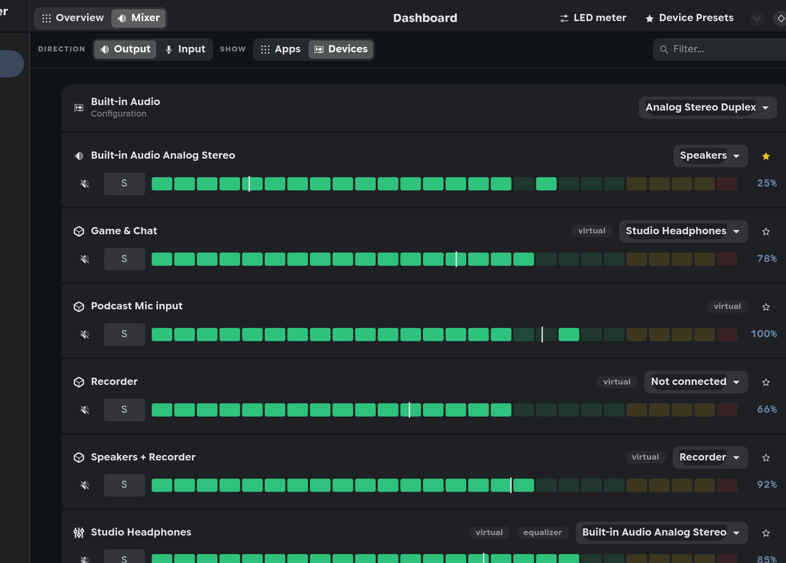

**Bug: the Mixer listed the app's own plumbing as if it were applications**

A filter chain, a loopback and a virtual device each look like a playing
application to the audio graph, so the Mixer listed them all. On a machine
with a few signal paths set up, that was seven rows of infrastructure —
"Everything output output", "Stream Mix (discarded) output" — against two real
applications, in the one list whose whole job is to tell you what is playing.

Only real applications are listed now. The plumbing is still counted on the
Running audio objects card and still shown one node at a time in the Patchbay,
which are the two places that are actually asking about the graph.

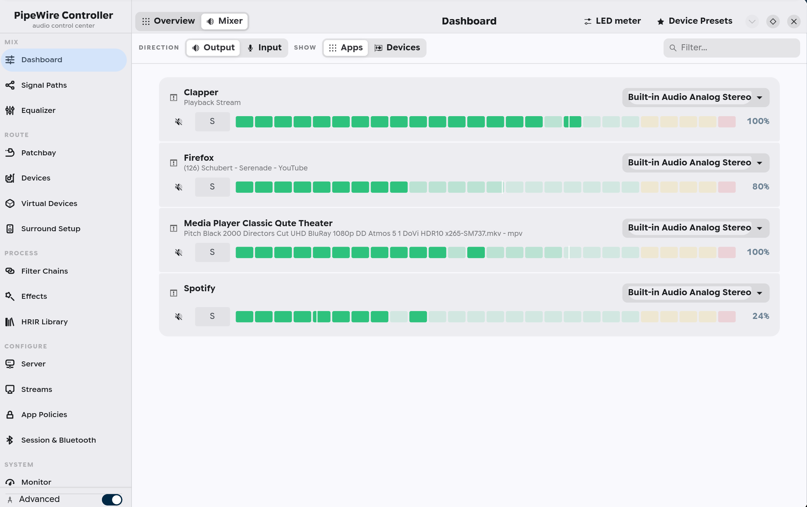

**Bug: whole plugin collections were missing from Effects and Signal Paths**

If you had the LSP or Zam plugins installed, the app did not list them — and on
Fedora, openSUSE or RHEL it may not have listed anything at all.

Two things were wrong. An LV2 plugin can be named in its manifest either by its
full address or by a shorthand, and only the first form was understood. LSP and
Zam both use the shorthand, so both collections were skipped everywhere — on a
typical install that is over two hundred plugins that were installed, working,
and invisible. It went unnoticed for so long because LSP also ships in the
older LADSPA format and that half was always detected, so the list never looked
empty.

The second was the search path. On Fedora and openSUSE, 64-bit plugins live in
`/usr/lib64`, which was never looked at — on Arch that folder is just another
name for one already scanned, so it never showed up in testing.

Both are fixed, and the scan now also looks in `/usr/local/lib64`. On a
development machine here the number of LV2 plugins found went from 92 to 322.

Reported by @GileonFletcher.

---

## [v0.5.1](https://github.com/knightinfected/PipeWireController/releases/tag/v0.5.1) — 2026-08-16

**App Policy bug fixes and additions- rules now have a direction, plus snapshot
updates and a launch fix**

- **Bug: an app can now have an output *and* an input rule.** Previously, adding the second
  one used to silently replace the first. Rules now have a direction, so a VoIP app
  can be routed to your speakers while also being assigned a microphone, and the
  dialog says which direction it is setting instead of listing every endpoint
  and leaving you to guess
  ([#7](https://github.com/knightinfected/PipeWireController/issues/7)).
  Existing rules keep working, covering both directions.
- **Rules now apply to apps that are already playing** — saving one moves what
  is playing to match, and **Apply now** does the same for every rule at once.
  Before, a new rule did nothing until you restarted the app.
- **Added a switch to turn a rule off** without deleting it, for finding out
  whether a rule is the one misbehaving.
- **Rules that cannot do anything now say so** — an unplugged device, or a rule
  sitting under an identical one that already wins, is flagged in the list.
- **Added pinning for apps sent to a signal path or an equalizer**, so they come
  back on their own after a restart. Right-click the app on a Signal Paths card,
  or press the pin on the Equalizer page.
- **Added pattern and inverted matching** for application rules, shown when
  Advanced is on — match a regular expression like `^(firefox|chromium)$`, or
  invert a rule to mean "every app except this one".
- **Added Update for patchbay snapshots** — save the current patchbay over an
  existing one, instead of deleting it and typing the name again
  ([#5](https://github.com/knightinfected/PipeWireController/issues/5)). Saving
  over one by name now asks first; it used to replace it silently.
- **Bug: the app would not start on a clean install** —
  `ModuleNotFoundError: No module named 'cairo'`. pycairo is needed for the
  patchbay, meters and signal-path wires, but it is only an optional dependency
  of python-gobject. Now a dependency of the AUR package (0.5.0-2) and listed in
  the README. Affected every release since v0.4.0.

---

## [v0.5.0](https://github.com/knightinfected/PipeWireController/releases/tag/v0.5.0) — 2026-08-10

**Renamed the package, the command and the desktop entry — the app is still
PipeWire Controller**

An unrelated project has held `pipewire-controller` on PyPI since February
2026. Nothing about the two is related, but they install the same
`/usr/bin/pipewire-controller` and the same `pipewire-controller.desktop`, and
because a desktop entry in your home directory outranks the system one, having
both could make this app's launcher entry silently disappear. Rather than
contest a name that was there first, this release moves out of the way:

- The package and the command are now **`pipewire-control-center`**, with
  **`pwcc`** as a short alias — quicker to type, and unlike `pwctl` it cannot
  be mistaken for `wpctl`, WirePlumber's own CLI.
- The desktop entry is now `io.github.knightinfected.PipeWireControlCenter.desktop`,
  matching the application ID so the window and its launcher icon are properly
  associated (and so it is ready for the planned Flatpak).
- On Arch, `pipewire-controller` stays on the AUR as a transitional package, so
  an ordinary upgrade moves you across — nothing to uninstall by hand.
- **Your settings are untouched.** `~/.config/pipewire-controller/` and the
  `99-pipewire-controller.conf` drop-ins keep their names, so every chain,
  signal path, equalizer and preference carries over as-is.

---

## [v0.4.0](https://github.com/knightinfected/PipeWireController/releases/tag/v0.4.0) — 2026-08-04

**Signal Paths — decide where audio comes in, what happens to it, and where it
goes**

A new page, and the first one that is about the *shape* of your audio rather
than about settings. A **source** is where sound enters — one app, a
microphone, or everything on the default output — and carries its own chain of
processing. A **mix** carries a chain of its own and feeds real devices.
Sources sit on the left, mixes on the right, and the sends between them are
drawn as curves, so a glance tells you what is going where.

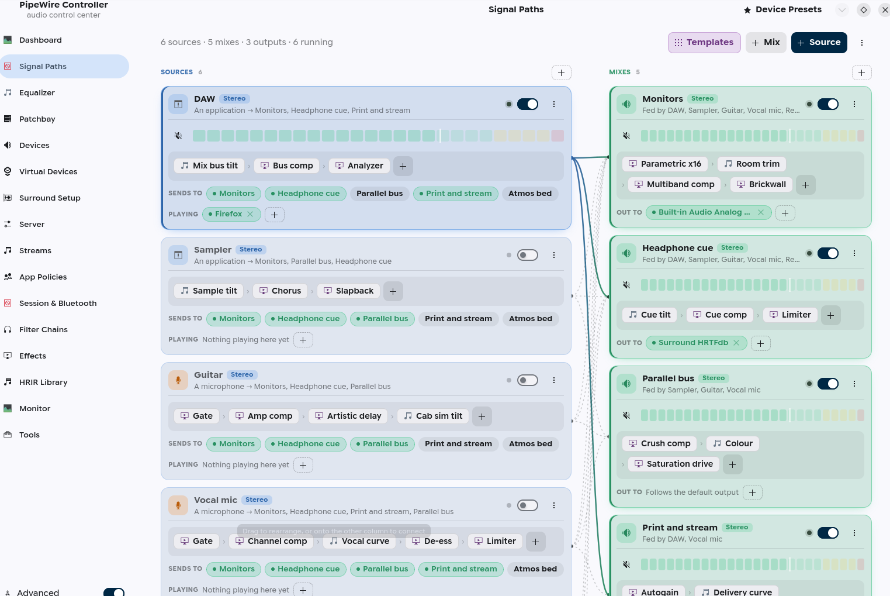

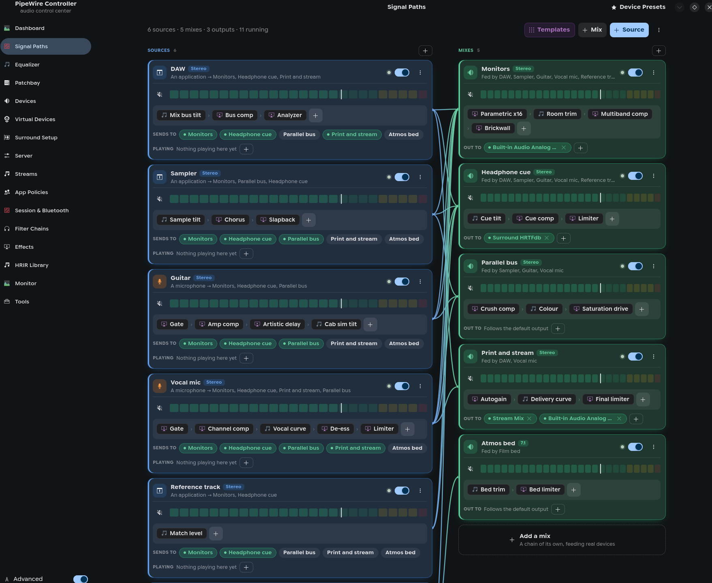

One source and one mix is a straight line, which is what most setups are. The
second column only earns its place once a chain has to split.

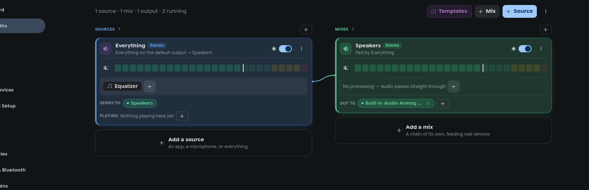

Splitting is the thing a single chain per output cannot do: one source
corrected four different ways, for four different pieces of hardware, without
building it four times.

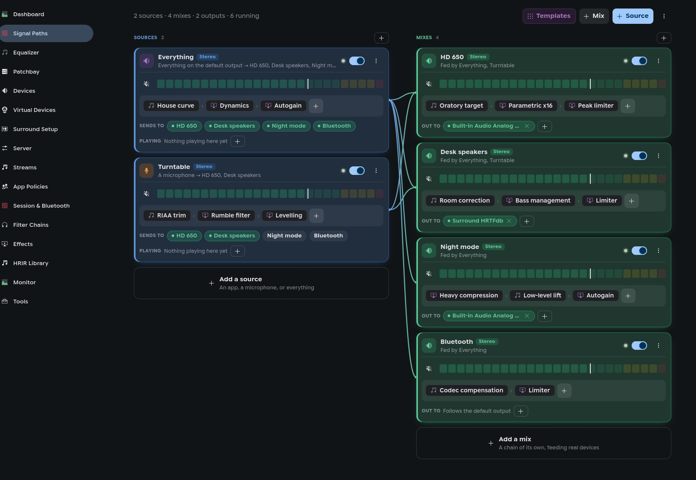

A mix on its own is a perfectly good path too — audio goes into it and out to
your speakers, with nothing in front.

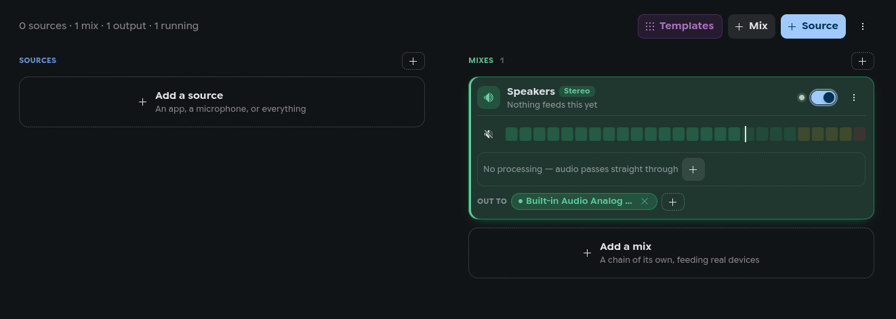

**You do not have to build any of it from scratch.** An empty board is the
template catalog: four complete paths that build both halves in one click, then
twenty-six ready-made strips running from the simplest at the top to the ones
people actually run for broadcast at the bottom — bass boost, a loudness curve
for listening quietly, crossfeed for headphones, a turntable chain, the
gate → tone → compressor → limiter voice chain, a mastering bus.

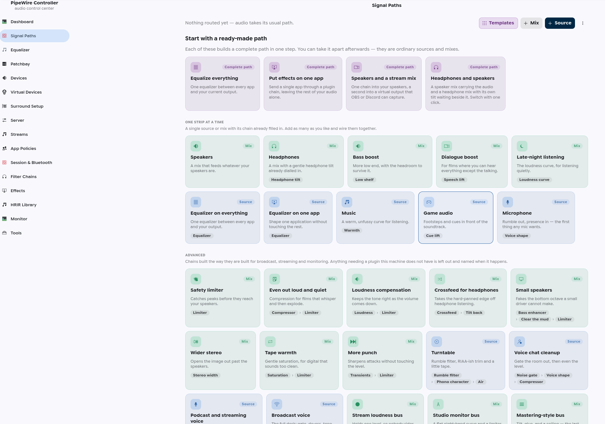

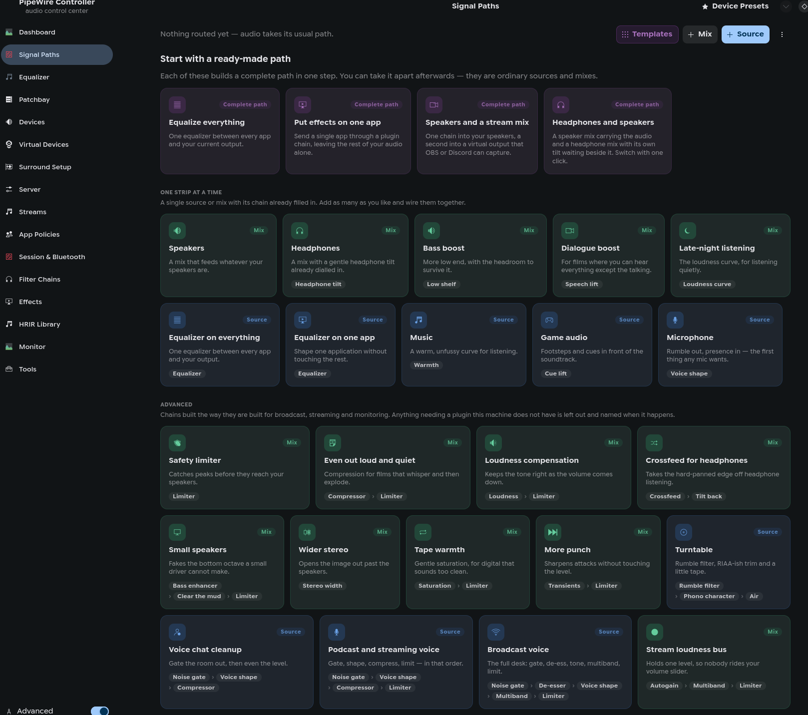

Each card draws the chain it is about to build. Anything wanting a plugin you
do not have says so on the card and is left out, rather than producing a strip
that will not start.

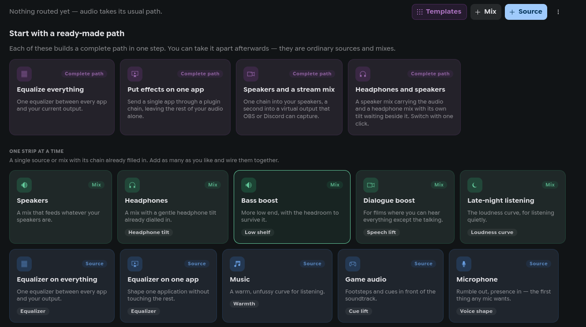

Once you have built something the catalog gets out of the way; the **Templates**
button up top opens it again as a searchable grid.

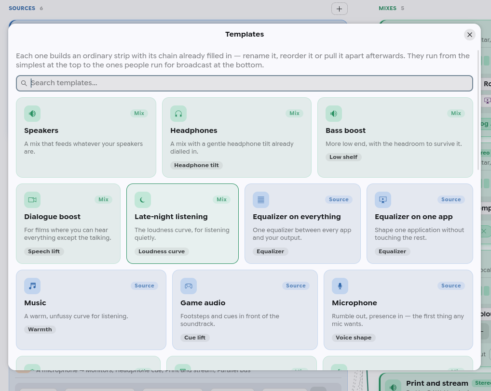

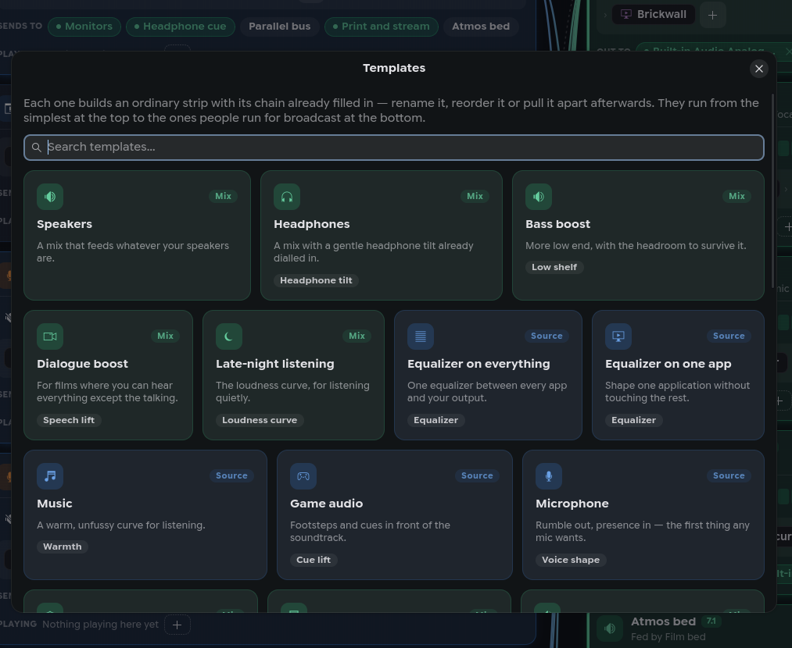

**Stages** are added to any strip: an equalizer whose bands you can move while
the audio plays, any LADSPA or LV2 plugin on the system, or an impulse response
file.

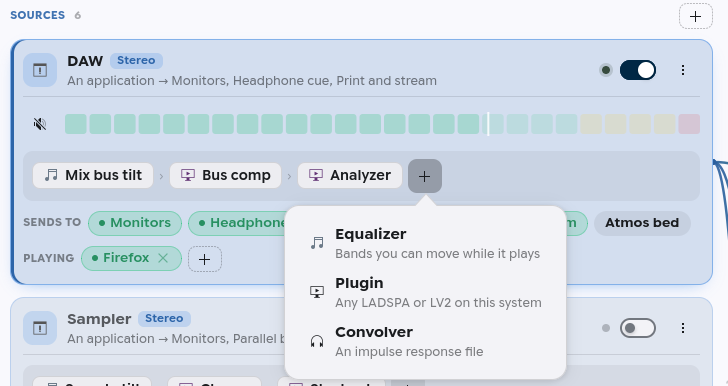

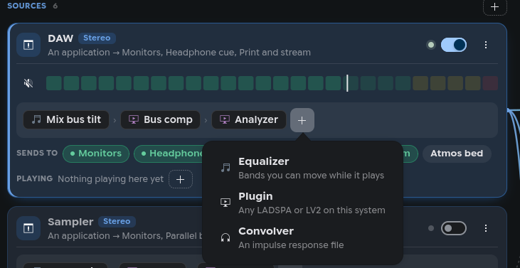

**Clearing up is one dialog.** Tick the strips to remove, or start the board
over — everything on it is listed with its chain, sends and state.

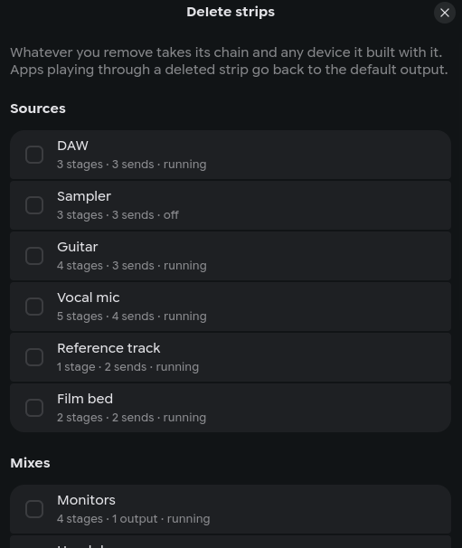

- **The board is handled directly, not through menus.** Drag a stage along its
  chain to reorder it, or onto another card to move it there. Drag a card to
  rearrange a column, or onto the opposite column to connect the two. Drag an
  app from one strip to another to move what it is playing through. While you
  are dragging, every place the thing could land says so, so you are never
  guessing at what is allowed.

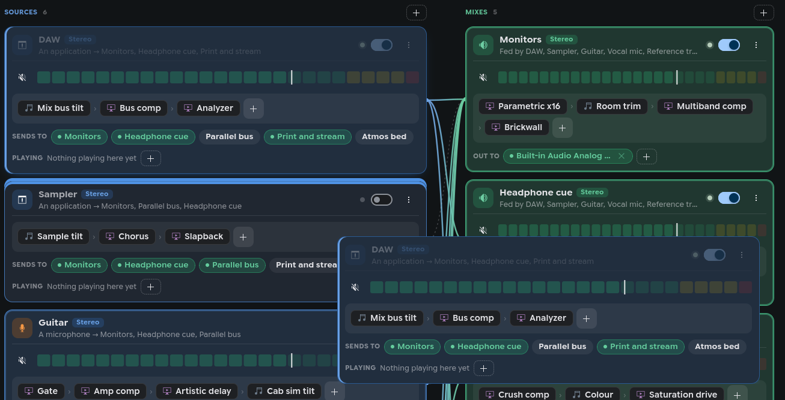

- **A stage answers a click.** One click takes it in or out of the signal;
  double-click or right-click opens it. Everything is on the menu too —
  bypass, reorder, duplicate, remove.

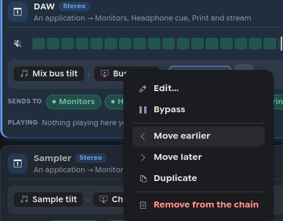

- **Volume controls follow the style you picked** for the rest of the app, so
  the board matches the Dashboard.

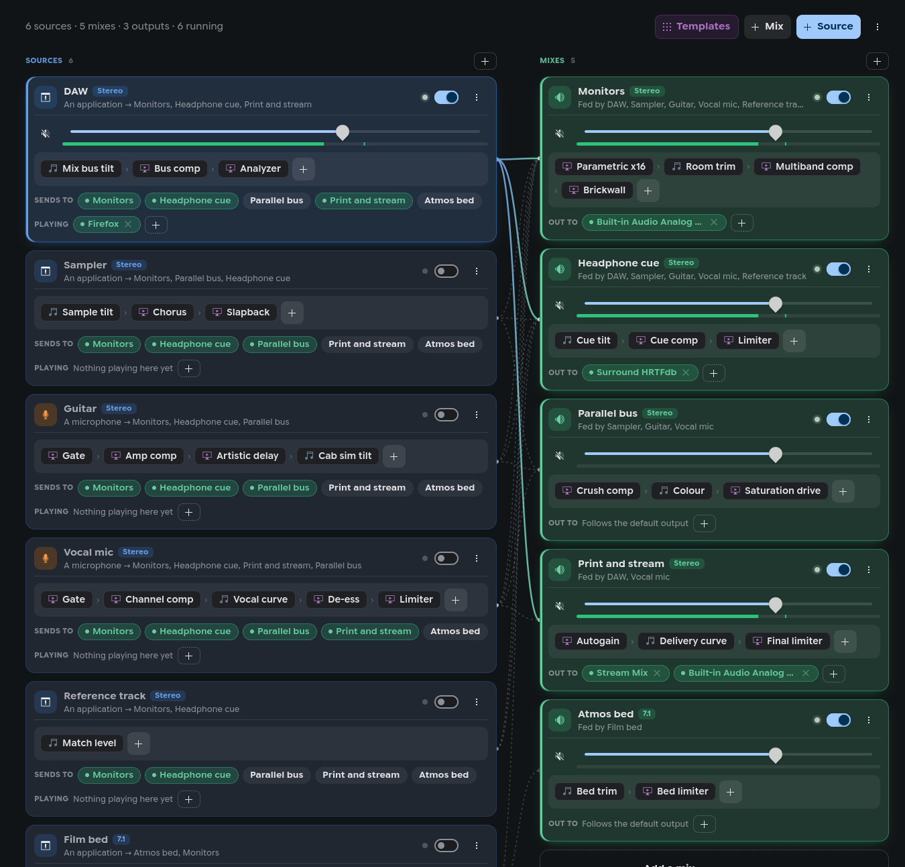

- **Colour tells you what you are looking at.** Sources are blue and mixes are
  green — the cards, the headings above them and the curves running between
  them use the same two colours, and a strip that is actually running carries
  its colour more strongly than one that is switched off. A send or an output
  turns green once it is carrying audio, so what is live is something you can
  see rather than something you have to read.
- **One process per chain, not one per plugin.** Every stage in a strip is
  compiled into a single filter graph: twenty effects are one entry in your
  device list and one buffer hop, instead of twenty of each. Hand-written
  configs force the opposite, which is how a serious chain ends up adding
  twenty quanta of latency.
- **Equalizer bands can be moved while the audio plays.** Signal Paths builds
  its equalizers from biquad filters rather than the preset-file kind, so
  frequency, gain and Q take effect as you change them — no restart, no gap.
- **Send one chain to several devices** and they are combined into one output
  for you; pick several outputs on a mix and the same thing happens. You never
  have to learn what a combine sink is.
- Chains, sends and outputs can be exported to a file and imported again.
  Imported paths arrive switched off so you can look before turning them on.

Fixed while building it:

- A board with more sources or mixes than fitted on screen **could not be
  scrolled** — the rest was simply cut off at the bottom of the window.
- The board **stopped following the graph**. A strip could be playing while its
  card still said nothing was playing there and showed no volume control at
  all; leaving the page and coming back was the only way to put it right. It
  now keeps up on its own, without tearing down a card you are working in.

**Effects and equalizers stop being dead ends**

- **An effect rack can feed another effect rack.** The output picker excluded
  every rack, including the ones you had just built, so rack → rack was the one
  combination that could not be made — while rack → equalizer already could.
  Racks, equalizers and filter chains now share one check, which also catches
  loops that run through a mix of them (equalizer → rack → equalizer) — those
  were invisible before.
- **Equalizers are no longer stereo-only.** A new channel layout row offers
  everything from mono to 7.1, so an equalizer can sit in front of a surround
  card instead of folding it down.
- **Any of them can play to several devices at once.** Tick the outputs and the
  combined device is built and selected for you.
- **Pages no longer get cut off in a narrow window.** One over-wide toolbar on
  the Patchbay was setting a floor for *every* page, so tiling the window or
  putting it on half a screen clipped the right-hand side of whatever you were
  looking at.

**Honest graph numbers, and meters that stay put**

Reported by [u/yhcheng888](https://www.reddit.com/user/yhcheng888/) on
r/linuxaudio, running the app next to Carla with a twenty-plugin signal chain —
thank you.

- **DSP load now means what it means everywhere else.** The Monitor page was
  reporting the busiest *single* node's processing time, so a long chain of
  plugin sinks read ~6% while Carla showed 43% for the same graph. It now
  reports the driver's cycle time against the quantum — the figure JACK-based
  tools report — averaged the way they average it.
- **The Monitor page samples every second, and you can change that.** It polled
  every three seconds, which is where the DSP load's lag came from — one
  `pw-top` sample is a single graph cycle, so a slow tick sees very few of
  them. A new **Sample rate** row (1/2/3/5 s) lets a plugin-heavy graph be
  watched closely or a slow machine spared; the load stays averaged over the
  same span whichever you pick, and the sparklines still cover ~3 minutes.
- **Xruns are counted as dropouts, not as error counters.** PipeWire raises an
  error count on the driver *and* on the node that overran, so adding up every
  node turned one dropout into several; the counter also ran from each node's
  creation rather than from when you started watching. The Monitor page now
  counts missed graph cycles since the page opened, with a reset button.
- **Level meters no longer go missing on big setups.** The cap on simultaneous
  meters was below the number of outputs a plugin-heavy system has, and rows
  past it showed an empty meter — indistinguishable from a silent device. The
  cap is higher, a row that can't get a meter shows none at all instead of a
  false one, and it picks one up as soon as another row lets go.
- **A restarted device gets its meter back.** A filter chain that restarts
  comes back with a new internal serial, and rows kept metering the old one —
  one device would sit silent while its neighbours worked.
- **Meters no longer outlive the app.** They are separate capture processes: if
  the app was killed or crashed they kept running, kept a link open on the
  device and kept appearing in `pw-top`. They are now stopped on exit however
  it happens, and any left over by an earlier run are cleared out at startup.
  They no longer appear in the Monitor page's node list either.
- **Patchbay: nodes that share a name no longer stack.** Two windows of the
  same app are two nodes with the same name, and they were drawn at exactly the
  same spot — one hidden under the other, its links apparently going nowhere.
  New nodes are also placed in the first free gap instead of blindly at the top
  of their column.
- **Patchbay: a connected monitor port is always shown.** Monitor ports are
  hidden by default as clutter, but chaining sinks through them is a normal way
  to build a signal path, and hiding those links made a node that was being fed
  audio look completely unconnected.
- **Equalizers can be chained.** An equalizer's Output device may now be
  another equalizer, so you can stack curves (room correction into a taste
  curve, say) instead of squeezing everything into one. Routings that would
  loop back on themselves are the only ones excluded.

**Hiding a device now really hides it — and there's a way back**

- **New "Hide the whole sound card" switch.** Hiding a single output or input
  only refuses that endpoint — the card itself stayed registered, so your
  desktop's sound settings kept offering it, profile switcher and all. The new
  switch disables the card and every input and output it provides, everywhere.
  ([#3](https://github.com/knightinfected/PipeWireController/issues/3))
- **The per-endpoint switch now says what it does** — "Hide this output" /
  "Hide this input", with a subtitle that spells out that the sound card itself
  stays listed. Both switches sit together on the device's own row.
- **Both switches are in the Patchbay too.** Double-clicking a node opens its
  dialog, which offered only the old endpoint hide; it now has the card-level
  one as well, and points at the Devices page for un-hiding — a hidden node
  can't be double-clicked to get it back.
- **New "Hidden devices" list, with Unhide.** A hidden device is gone from the
  audio graph, so it used to disappear from PipeWire Controller too and the
  only way back was deleting the generated WirePlumber file by hand. Hidden
  endpoints and cards are now listed at the bottom of the Devices page and can
  be brought back with one click.
- **A hide that isn't actually in effect is flagged.** If the generated
  WirePlumber file was removed or edited by hand, the app no longer insists the
  device is hidden — the entry is marked *not in effect*, and Unhide clears it.

---

## [v0.3.6](https://github.com/knightinfected/PipeWireController/releases/tag/v0.3.6) — 2026-07-29
**Everything shows its level — plus the new Equalizer and Microphone cleanup pages**

- **Live level meters everywhere.** Every volume control in the app now shows
  the audio actually flowing through it — the Dashboard mixer, both device
  tabs, the Devices page and the equalizers. You can see at a glance which app
  is making noise, whether a device is really passing audio, and how loud it
  is. Meters are dB-mapped, so normal listening fills the bar instead of
  sitting near zero, and they carry a peak-hold marker.
- Metering costs effectively nothing: PipeWire's own resampler reports the
  peaks, so each meter reads about **100 bytes per second** rather than
  streaming audio. Meters run only while their row is on screen, they can't
  keep a device awake, and they never appear as nodes in the Patchbay.

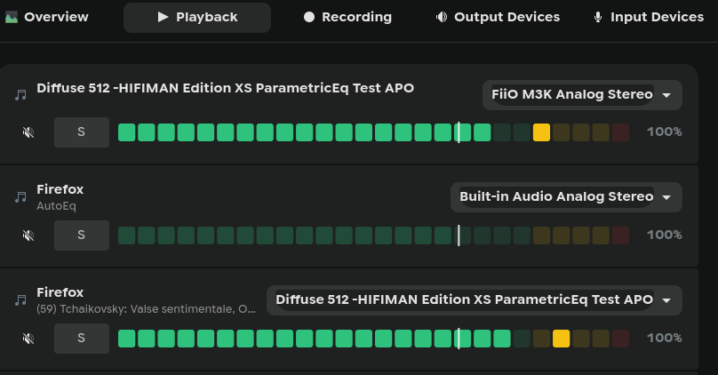

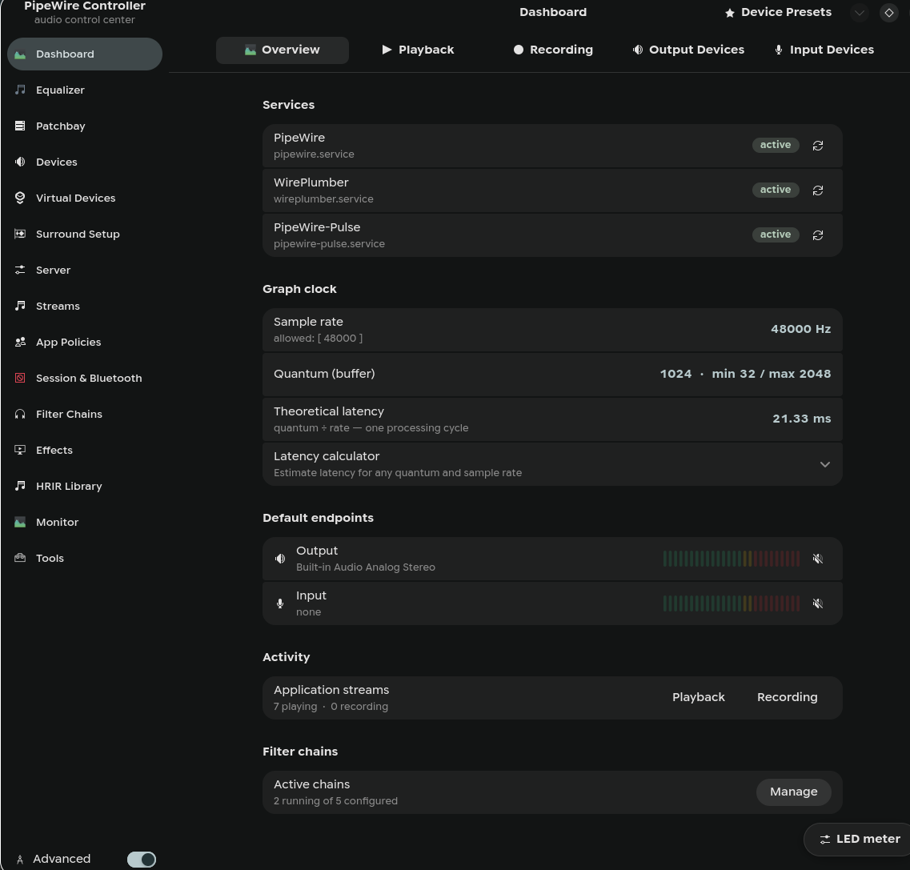

- **Equalizer page** — parametric-equalizer outputs you route audio through.
  Import an AutoEQ / APO `ParametricEq.txt` (browse or just drag the file onto
  the row), or dial the bands in by hand: each band has its own type, frequency,
  gain and Q, and its own switch so you can hear one filter in isolation without
  deleting it. One click makes an equalizer the default output.
- **Live A/B compare** (beta) — switch an equalizer in and out *while it keeps
  running*, so playback never pauses. Bypassed audio goes straight to the
  output device.

<p align="center">
  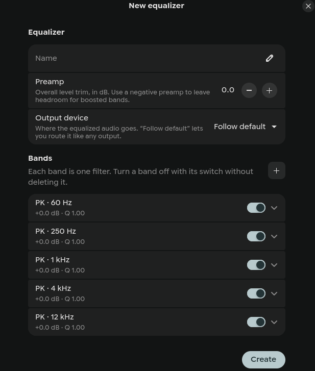
  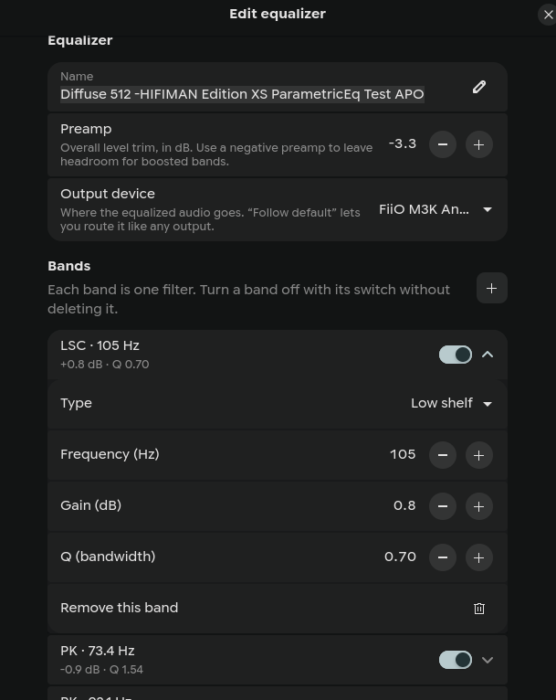
</p>

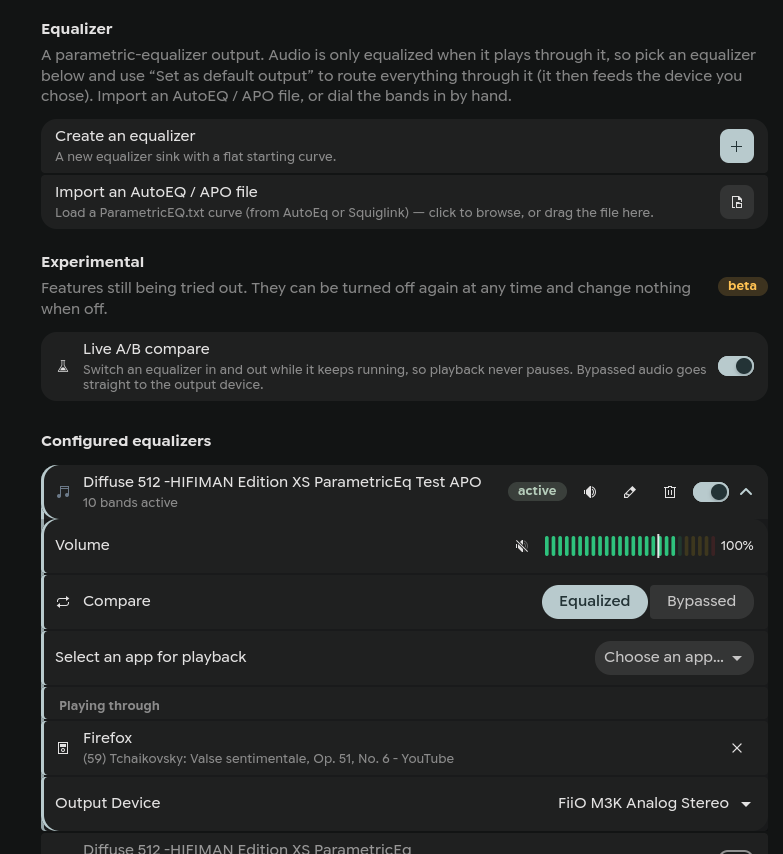

- **Microphone cleanup** — a clean copy of your microphone with echo and
  background noise removed (WebRTC). Noise suppression, automatic gain, a
  high-pass filter and voice-activity detection are individual switches, with
  extended-filter, delay-agnostic and transient suppression under Advanced. By
  default it uses whatever is playing on your speakers as the echo reference,
  so there is nothing to route.

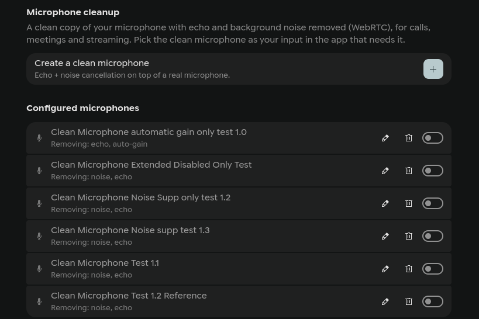

<p align="center">
  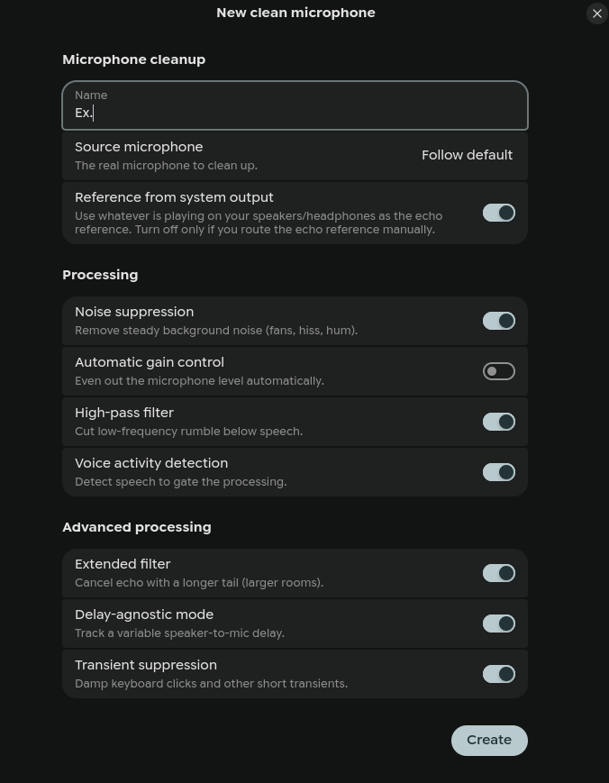
</p>

- **Clearer running devices.** A running equalizer or microphone is marked with
  an accent edge that runs the whole height of its block, stopped ones step
  back, and the inline mixer is laid out as the signal path — level, compare,
  what is playing through it, where it goes.
- **Fixed:** text containing `&` or `<` made a row's title or subtitle vanish
  entirely. This hit stream names reported by apps, device descriptions and
  anything you had typed yourself — equalizer, filter-chain and virtual-device
  names, app policies and HRIR filenames.

---

## [v0.3.5](https://github.com/knightinfected/PipeWireController/releases/tag/v0.3.5) — 2026-07-29
**Bug fixes related to Card Config and additions- Card configuration is its own control — with a way out of a broken profile**

- **Configuration switcher is now a dedicated row**, one per card, on the
  Output/Input Devices tabs — instead of riding on one arbitrary device row.
  It no longer jumps between rows or disappears when a profile exposes several
  sinks at once (Pro Audio) or none at all (Off), so the switcher — and the way
  back — is always reachable.
- **Added One-click Reset to a working profile** when a card gets stuck. WirePlumber
  can save a profile that later can't work (e.g. an HDMI-surround profile saved
  while nothing is plugged into HDMI), leaving you with no audio and, before,
  no obvious way out.
- **Added "unavailable" warning** — the ⚠ now flags only profiles that are
  genuinely unavailable, so a playable-but-unprobeable profile like *Pro Audio*
  is no longer falsely marked.

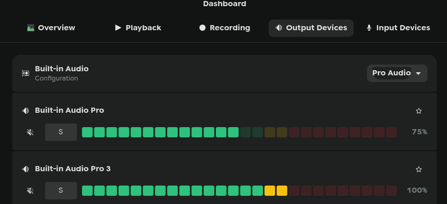
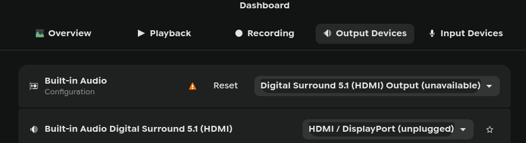

---

## [v0.3.4](https://github.com/knightinfected/PipeWireController/releases/tag/v0.3.4) — 2026-07-27
**Import your existing virtual devices**

- **Import existing devices** (Virtual Devices page) — adopt loopback,
  combine, and null-sink drop-ins you hand-wrote in
  `~/.config/pipewire/pipewire.conf.d`. They're classified into the right kind
  (null sink · virtual mic · bus · combined), imported disabled, and the
  original file is moved into an `inactive/` folder so it loads only once (no
  duplicate). A file picker covers configs kept elsewhere.
- The header-bar bookmark button is now labelled **Device Presets** so it reads
  clearly next to the star.

---

## [v0.3.3](https://github.com/knightinfected/PipeWireController/releases/tag/v0.3.3) — 2026-07-25
**Virtual-device fixes — Mono layout and no more stray mic routing**

- **Mono 1.0 layout** for virtual devices — null sinks, virtual mics,
  aggregates, and buses can now be created as mono. Editing an existing mono
  device selects the right layout too.
- **Fixed virtual mics auto-routing to the default sink** — the null-source
  playback stream now sets `node.autoconnect=false` (matching the null-sink and
  Pro Audio map nodes), so WirePlumber no longer links a virtual mic onto your
  speakers.

---

## [v0.3.2](https://github.com/knightinfected/PipeWireController/releases/tag/v0.3.2) — 2026-07-23
**Pro Audio channel maps and a dashboard configuration switcher**

- **Pro Audio channel map** (Virtual Devices) — map a friendly channel layout
  onto the generic AUX channels a card exposes in its *Pro Audio* profile
  (e.g. a stereo sink whose FL/FR land on the interface's AUX0/AUX1). Both
  output and input directions, arbitrary N-channel maps. The links survive
  reboots and PipeWire restarts.
- **Dashboard configuration switcher** — change a card's profile (Analog
  Stereo Duplex, Pro Audio, HDMI, Off, …) straight from the Output/Input
  Devices tabs, like pavucontrol's Configuration tab.
- **`pyproject.toml`** — a proper Python project (metadata, entry point, and
  dev tooling for type-checking/linting).
- Virtual-device dialog is now a **resizable window** with a larger default
  size; fixed note-wrapping and dropdown truncation in that dialog.

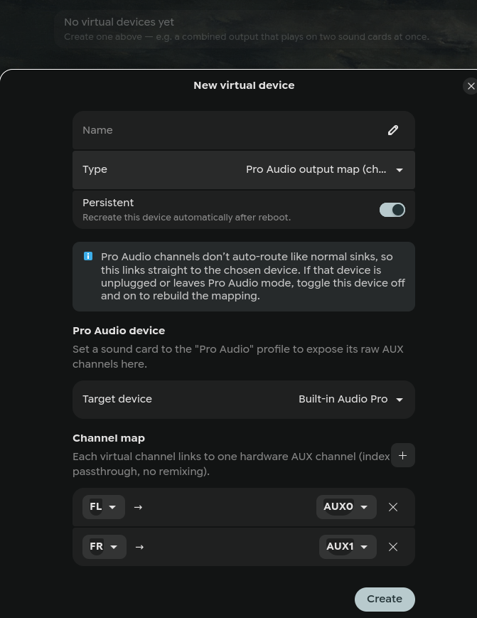
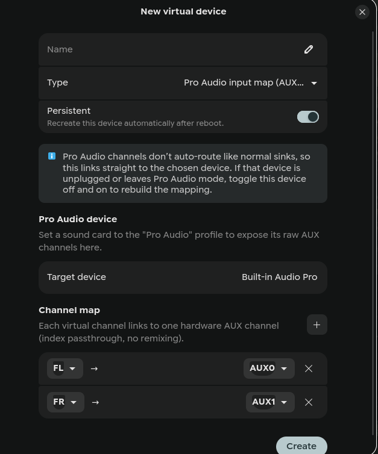
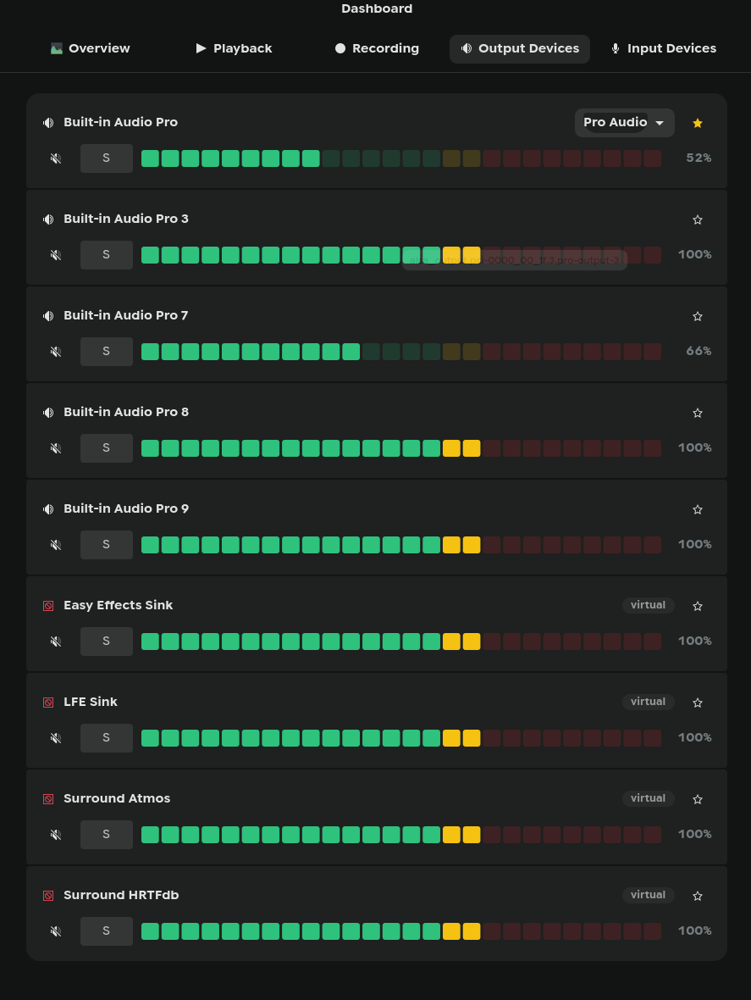
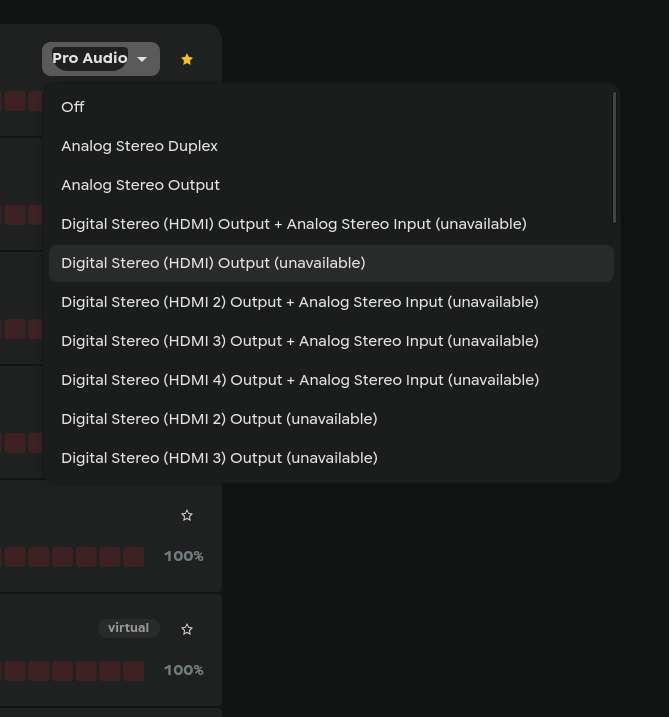
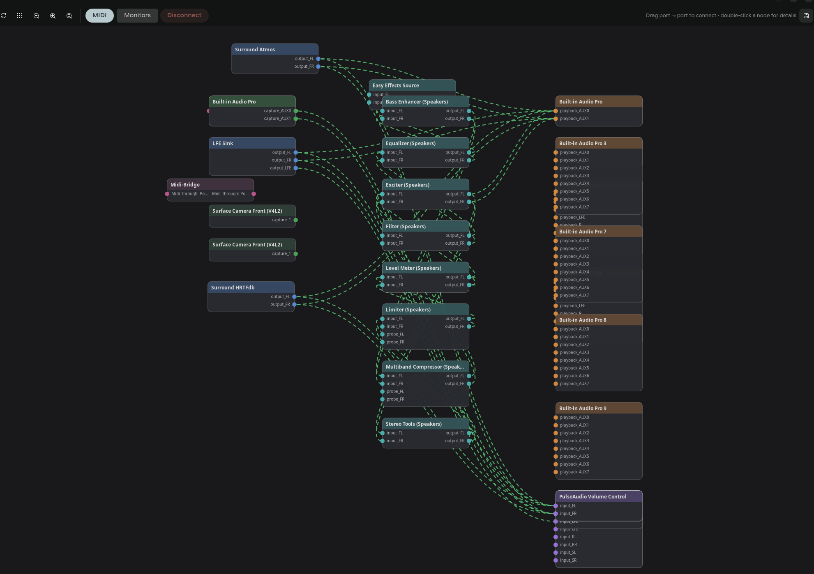

---

## [v0.3.1](https://github.com/knightinfected/PipeWireController/releases/tag/v0.3.1) — 2026-07-23
**Server tuning fixes — feedback from Wim Taymans (creator of PipeWire)**

- Raised the quantum hard-limit ceiling (8192 was only ~43 ms at 192 kHz;
  the dropdown now reaches 32768, real cap 65536) and explained the
  frames-vs-rate trade-off inline.
- Corrected the `link.max-buffers` description (it's mostly about video
  buffers, not audio) and its default.
- Added a **Custom…** typed entry to the Default/Minimum/Maximum quantum
  dropdowns for values off the preset list.

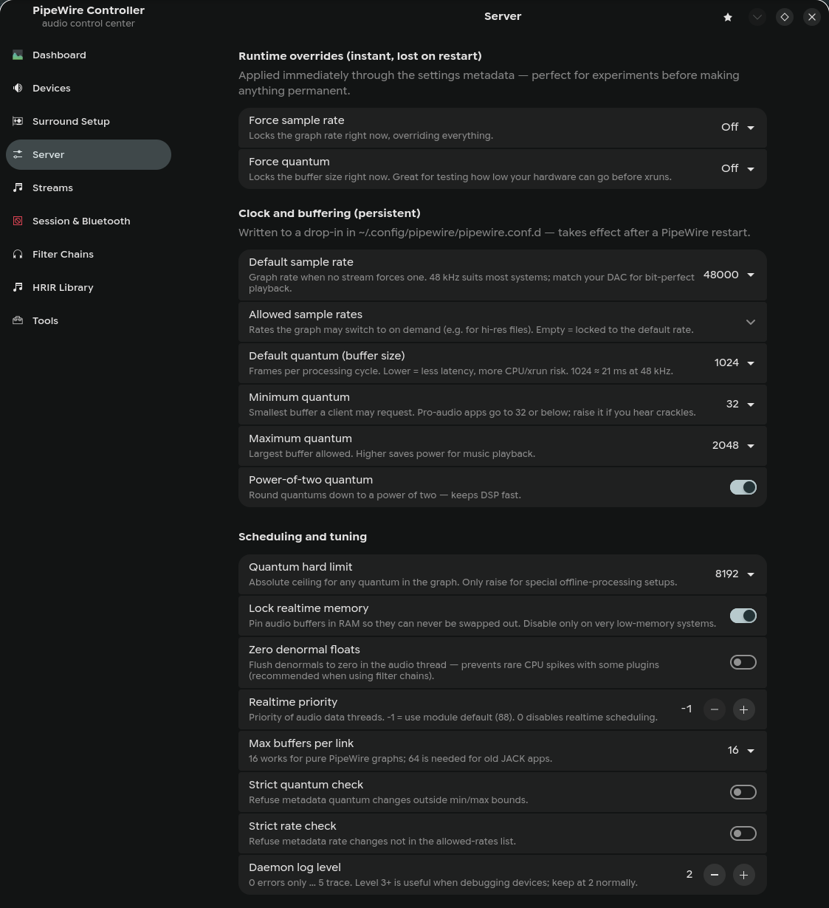

---

## [v0.3.0](https://github.com/knightinfected/PipeWireController/releases/tag/v0.3.0) — 2026-07-22
**The big one — Patchbay, Monitor, Virtual Devices, Effects, App Policies**

- **Patchbay** — live audio + MIDI node graph, drag-to-connect, node metadata
  editor, routing snapshots (save/recall/export/import).
- **Monitor** — service CPU/RAM, xruns, DSP load, live `pw-top`, journal
  follow, desktop notifications.
- **Virtual Devices** — null sinks, virtual mics, combine/aggregate devices,
  buses.
- **Effects** — LADSPA/LV2 discovery and an insert-rack chain.
- **App Policies & per-device rules** — per-app routing, default-device
  priority, clock master, per-device rate/format/period/headroom/rename/hide,
  plus per-device Bluetooth profile & codec and dashboard mixer solo.

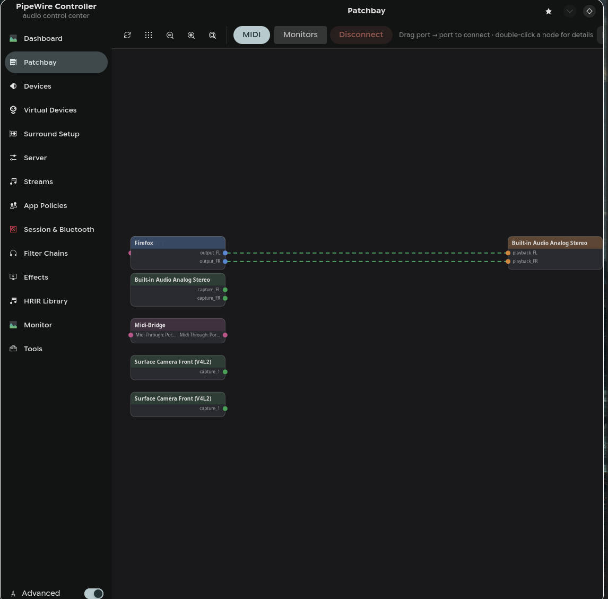
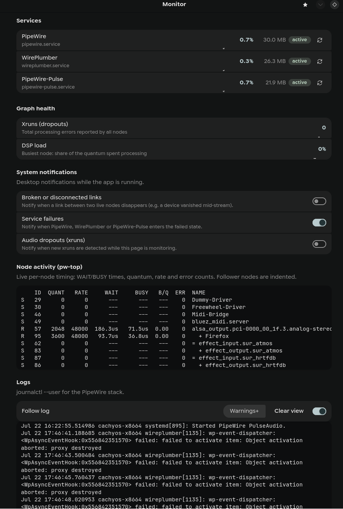
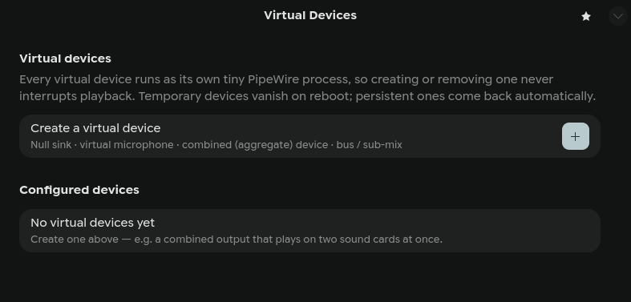
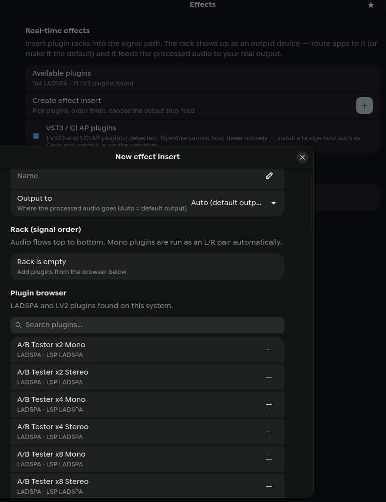
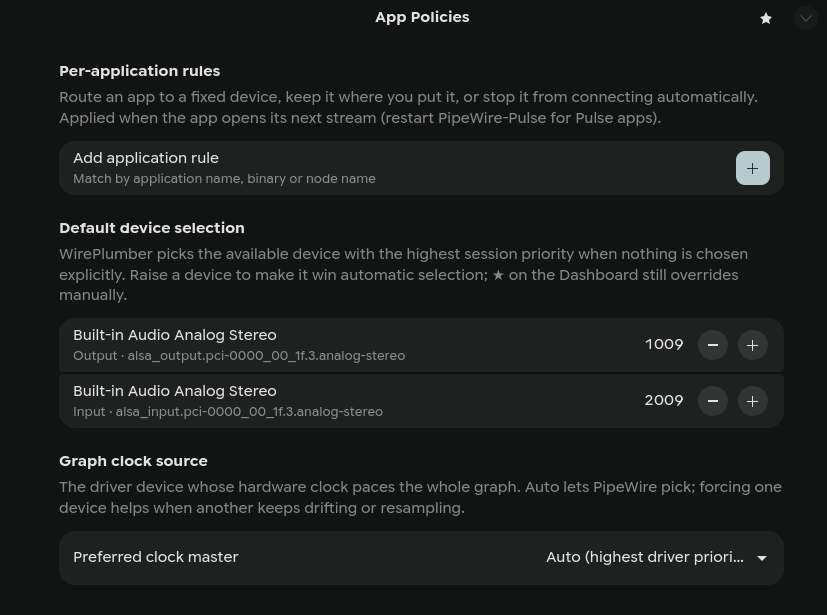
