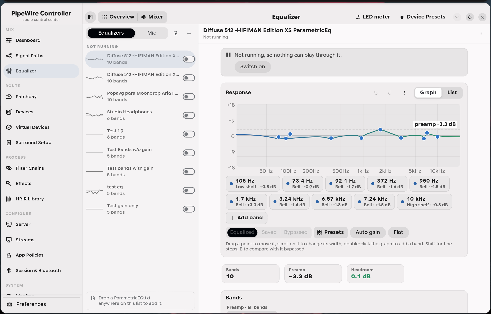
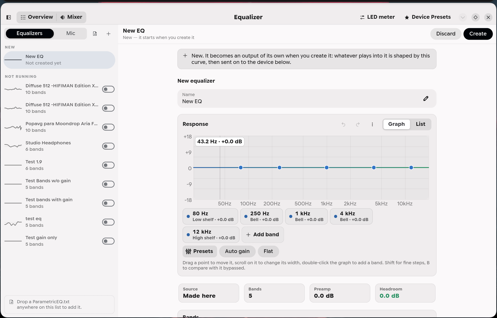
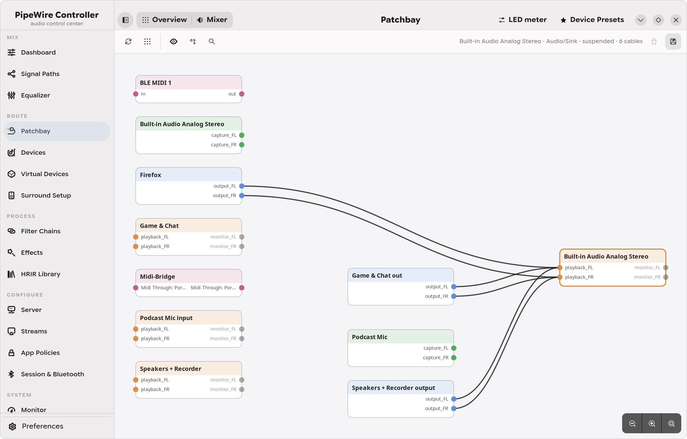
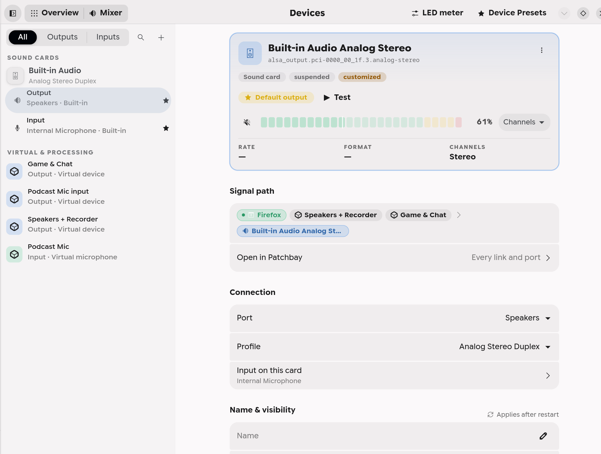
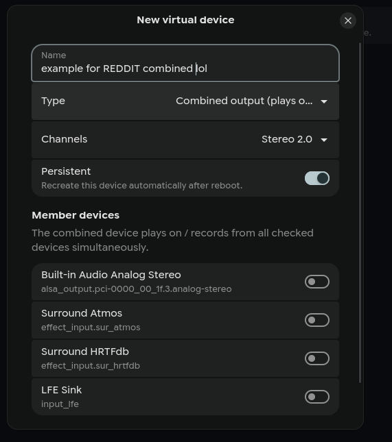
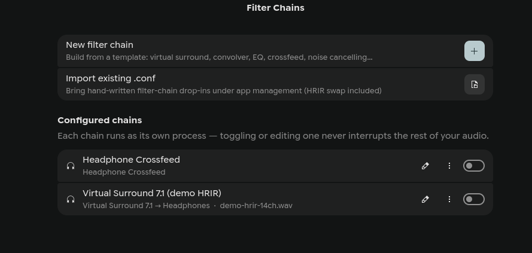
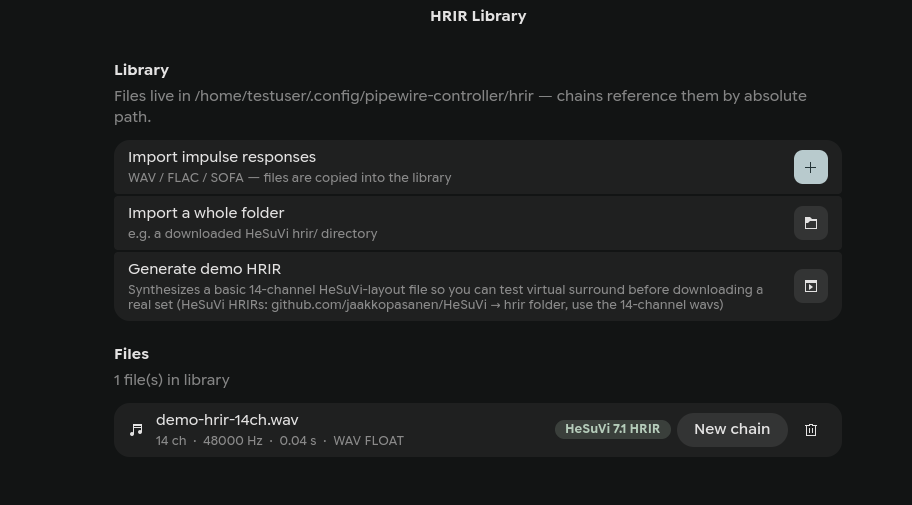
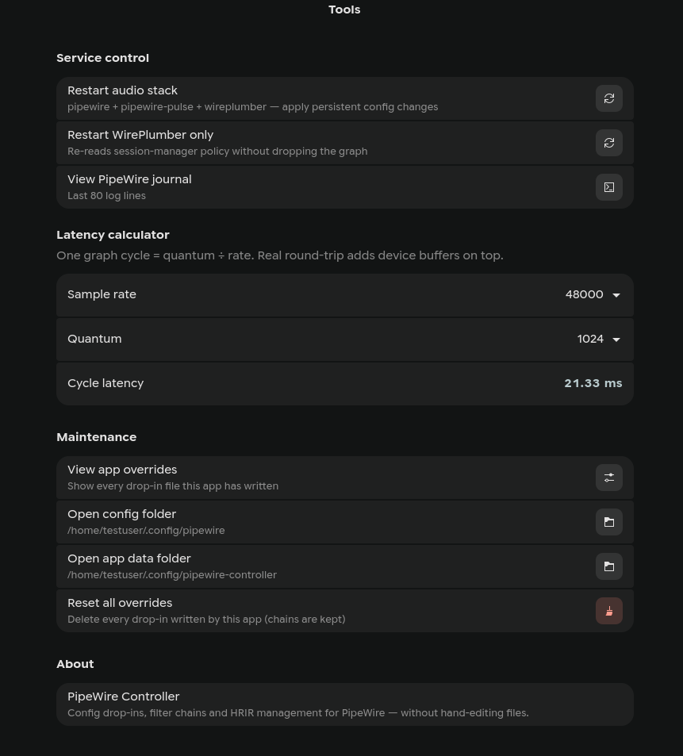
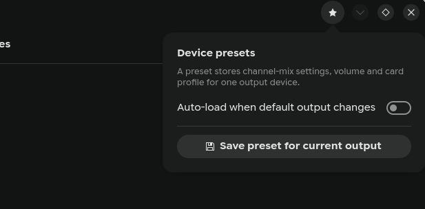

# Features

Everything PipeWire Controller can do. The first part is a list of tasks, from
everyday to advanced. The second goes through the app page by page, in the
order of its sidebar.

[Back to the README](README.md) · [Every screenshot](screenshots/) ·
[Changelog](CHANGELOG.md)

- [What do you want to do?](#what-do-you-want-to-do)
  - [Everyday](#everyday) · [Going further](#going-further) · [Advanced](#advanced)
- [Page by page](#page-by-page)
  - [Mix](#mix): Dashboard, Signal Paths, Equalizer
  - [Route](#route): Patchbay, Devices, Virtual Devices, Surround Setup
  - [Process](#process): Filter Chains, Effects, HRIR Library
  - [Configure](#configure): Server, Streams, App Policies, Session & Bluetooth
  - [System](#system): Monitor, Tools
  - [All over the app](#all-over-the-app)
- [How it works](#how-it-works)

## What do you want to do?

### Everyday

| I want to… | Go to |
|---|---|
| turn one app down, or move it to another device while it plays | **Dashboard** → *Mixer* |
| balance my speakers, or turn down one side of my headphones | **Dashboard** → *Mixer*: the *Channels* button on any row |
| keep the devices I use most one glance away | **Dashboard** → *Favorites*: pin any output, input or virtual device |
| switch between speakers and headphones on the same card | **Devices**: pick the card's output, then *Port*. It's also on the device's row in **Dashboard** → *Mixer* |
| check an output works, and which side is which | **Devices** → *Test*: a short chime, left then right |
| play on two devices at once | **Virtual Devices** → *Combined output* |
| EQ my headphones with an AutoEQ profile | **Equalizer**: drop the `ParametricEq.txt` on the list, or import it |
| stop my mic picking up echo and room noise | **Equalizer** → *Mic*, then pick the clean mic as your input |
| hear 7.1 surround on headphones | **Surround Setup** → *Virtual 7.1 Headphones* |
| set up real 5.1 or 7.1 speakers | **Surround Setup**: a wizard with a test tone for each speaker |
| get better Bluetooth audio | **Session & Bluetooth**: SBC-XQ, mSBC, and a codec per device |
| stop the pop or cut-off at the start of sounds | **Session & Bluetooth** → never suspend devices |
| work out why the audio crackles | **Monitor**: dropouts, DSP load and a live `pw-top` |
| start it with my computer, quietly in the background | **Preferences** → *Startup* |
| put every setting back the way it was | **Tools** → *Reset all overrides* |

### Going further

| I want to… | Go to |
|---|---|
| send one app somewhere else, and keep it there | **Dashboard** → *Mixer* for now. **App Policies** makes it permanent |
| build a voice chain for streaming | **Signal Paths** → *Templates*: gate, tone, compressor, limiter in one click |
| correct one source differently for each of my devices | **Signal Paths**: one source sending to several mixes, each with its own chain |
| give a group of apps one volume and one destination | **Virtual Devices** → *Bus / sub-mix* |
| make a virtual microphone other apps can record from | **Virtual Devices** → *Virtual microphone* |
| record from several inputs as one | **Virtual Devices** → *Combined input* |
| connect every channel of one device to another, or inputs 1-8 to 9-16 | **Patchbay**: drop a cable on a node's title, or *Connect channels* |
| save my whole routing and get it back later | **Patchbay** → *Routing snapshots* |
| have my settings follow me when Bluetooth headphones connect | **Device Presets** (top right) → *Auto-load when default output changes*. The app has to be running: **Preferences** → *Startup* can keep it in the background |
| change a device's sample rate or bit depth, rename it, or hide it | **Devices**: pick the device. The settings are under *Name & visibility* and *Format & timing* |
| try a change to my EQ curve without losing the one I have | **Equalizer**: edit it, then *Compare* → *Saved*. Or *Duplicate* it first |
| lower my latency | **Dashboard** → *Latency calculator* → *Test live* |
| run LADSPA or LV2 plugins on my audio | **Effects**: build a rack, then send apps to it like any output |
| use my own HRIR, from HeSuVi for example | **HRIR Library**: import the file or folder, then *New chain* on the file |
| hear only one app for a moment | **Dashboard** → *Mixer*: its solo button |

### Advanced

| I want to… | Go to |
|---|---|
| play into chosen channels of an interface, like outputs 3 and 4 | **Virtual Devices** → *Channel map output* |
| record chosen inputs of an interface as their own microphone | **Virtual Devices** → *Channel map input* |
| try another sample rate or buffer size without committing to it | **Server** → *Force sample rate* / *Force quantum*. A restart undoes it |
| set the default and allowed sample rates, or the quantum limits, for good | **Server** |
| choose the resampler quality, or how stereo is upmixed to surround | **Streams** |
| decide which device wins when several are plugged in | **App Policies** → *Default device selection* |
| choose which device's clock paces the whole graph | **App Policies** → *Preferred clock master* |
| stop an app connecting on its own, or pin it so it never follows the default | **App Policies** → *Add application rule* |
| set a stream's target by hand (`target.object`) | **Patchbay**: double-click a node, then *Metadata* |
| bring filter chains or loopbacks I wrote by hand under the app | **Filter Chains** → *Import existing .conf*, and **Virtual Devices** → *Import existing devices* |
| edit a filter chain's config as text | **Filter Chains**: the chain's raw editor checks the text before saving |
| check a convolver chain isn't clipping | **Filter Chains**: the chain's *Level* section, and the *Too loud* tag in the list |
| find the quantum hard limit, RT scheduling, strict checks and similar | they're shown by default. *Show advanced settings* in **Preferences** → *General* hides them |

## Page by page

The sidebar groups the pages into five sections, and this follows the same
order.

### Mix

**Dashboard.** Two views, picked from the switcher in the window header.
*Overview* leads with your default output and input and a *Favorites* card:
pin any output, input or virtual device, and its volume, mute and live meter
stay on the dashboard. Unplug a favorite and it keeps its place under its own
name, then comes back on its own. *Overview* also has the **latency
calculator**, with a one-click *Test live* through force-quantum and
force-rate. *Mixer* lists apps or devices, playing or recording:
- **Apps** lists only real applications, not the filter chains, loopbacks and
  virtual devices that look like apps to the audio graph. Each has volume,
  mute, solo, and a device picker that **moves the stream while it plays**.
  A recording stream can capture any input, or what any output is playing.
- **Devices** has volume, mute, the default star, and the port (speakers,
  headphones, HDMI, with unplugged ones marked) or card profile. A software
  device is tagged with what it is (*filter chain*, *signal path*,
  *equalizer*, *mic cleanup* or *loopback*) and gets an **Output device**
  picker, so you can see and change where its audio goes. This works for
  things the app didn't create, too.
- **Channels**, on every app and device, opens a balance slider and one
  slider per channel: front left and right, centre, subwoofer and so on, or
  AUX on a Pro Audio card. Every other volume slider keeps that balance.

  
  

**Signal Paths.** Build the route your audio takes. A **source** is where
sound enters: one app, a microphone, or everything on the default output, each
with its own chain of processing. A **mix** has a chain of its own and feeds
real devices. Sources sit on the left, mixes on the right, and the sends
between them are drawn as curves.
- **An empty board is the template catalog**: four complete paths, then 26
  ready-made strips, from bass boost and crossfeed for headphones up to a
  broadcast voice chain and a mastering bus. Anything that needs a plugin you
  don't have says so on its card and is left out.
- **Everything is drag and drop.** Drag a stage along its chain to reorder it,
  or onto another card to move it. Drag a card onto the opposite column to
  connect the two. Drag an app between strips to move what it's playing. A
  click takes a stage in or out of the signal; a double-click opens it.
- **One process per strip.** Twenty effects are one entry in your device list
  and one buffer hop, and changing a strip restarts only that strip. Send one
  strip to several devices and they're combined into one output for you.
- **Plugins PipeWire can't host on your system are greyed out** in the
  picker, with the reason, instead of building a strip that won't start.

  
  

**Equalizer.** Parametric equalizers you route audio through, listed beside
the one you pick. Drag a point on the curve to move a band, scroll on it to
change its width, and double-click the graph to add one. A running equalizer
plays every change as you make it. **Compare** switches between your edit,
the saved curve and no equalizer at all, at the same loudness, without
pausing anything that plays through it. Start from an AutoEQ or Equalizer
APO `ParametricEq.txt` (drop it on the list, or paste what AutoEq's site
copies), from a preset, or from scratch: bell, shelves, low and high cut,
and notch. *Auto gain* sets the preamp so nothing clips, and there's undo,
*Save* and *Revert*. Send an equalizer to one device, to several at once or
into another equalizer, or make it the default output.

**Mic**, the page's second tab, makes a clean copy of your microphone with
echo and background noise removed (WebRTC). Noise suppression, automatic gain,
a high-pass filter and voice detection are separate switches. It uses what's
playing on your speakers as the echo reference, so there's nothing to route:
pick the clean mic as your input. A before and after level shows the
difference while an app records from it.

  
  

### Route

**Patchbay.** A live graph of every node, port and cable in the session,
audio and MIDI. Drag a port onto another to connect, or drop the cable on a
node's title to connect every channel at once. **Connect channels** does
ranges, such as an interface's inputs 1-8 into a DAW's 9-16, and lists every
cable before it makes them. While you drag, the ports that can take the cable
light up and the toolbar says what letting go will do. Select a node and its
cables stand out; right-click (or long-press) anything for its menu.
*Arrange* lays the graph out by signal flow, apps on the left and devices on
the right, and your layout is kept. Search with Ctrl+F, zoom where you point,
and show or hide MIDI, monitor ports and video. Double-click a node for its
properties, its latency and a **metadata editor**. **Routing snapshots** save
every link, the default devices and the volumes under a name, to apply,
export or import later.

**Devices.** Every output and input, hardware and software, in one list
grouped into sound cards, Bluetooth and virtual devices, with a live level on
anything playing. Pick one to see it in full: how it's connected (with the
Bluetooth codec), its rate and format while it plays, **what's playing into
it and where its sound goes** (click an app to move it, or drag it onto
another device in the list), its port and profile with a one-click fix when
a profile gives no sound, its *Channels*, and a **Test** chime. A hardware
device's **settings** are right there too: name, hiding, sample rate, bit
depth, ALSA period size, headroom, preferred quantum and suspend timeout,
saved as WirePlumber rules.

  
  

**Virtual Devices.** Each runs as its own small process, temporary or kept
across reboots, so making or removing one never interrupts playback:
- *Virtual output* (null sink) and *Virtual microphone* (null source)
- *Combined output*, which plays on several devices at once, and *Combined
  input*, which records several as one
- *Bus / sub-mix*, a group you can route as one device
- *Channel map output* and *Channel map input*: play into, or record from,
  chosen channels of any device. That covers outputs 3–4 of an interface, the
  rear pair of a surround card, or a few inputs published as their own mic.

**Import existing devices** adopts loopback, null-sink and combine drop-ins
you wrote yourself, and moves the original into an `inactive/` folder next to
it so PipeWire doesn't load it twice.

  
  

**Surround Setup.** A wizard for real 5.1 and 7.1 speakers. Choose the
layout, pick the matching card profile (★ marks the right one, and it doubles
as a Bluetooth codec picker), apply recommended upmix and bass settings, then
click each speaker on a room map to hear a test tone. For headphones there's a
one-click **Virtual 7.1 Headphones** output. It's marked as virtual, never made
the default on its own, and removed like any other chain.

### Process

**Filter Chains.** Create, edit, clone, enable, disable and delete
PipeWire filter chains without writing one.
- **Each chain runs as its own process**, so changing one, or swapping its
  HRIR, restarts only that chain. Your main audio never skips.
- **Templates**: HeSuVi virtual surround 7.1, 5.1 and stereo widening (from a
  14-channel HRIR), a plain 7.1 sink, true-stereo and stereo convolvers, SOFA
  spatializers, headphone crossfeed, parametric EQ, bass boost, and an RNNoise
  mic. The right one is picked from the IR file you choose.
- **A Level section** shows where a convolver chain peaks, measured from its
  own IR files, and new chains get a safe gain automatically. A chain that
  would clip is tagged *Too loud* in the list.
- **A chain that would fail to start is refused up front**, naming what's
  missing, instead of failing with an error that explains nothing.
- **Import** brings your hand-written drop-ins under the app as they are,
  comments and all, with HRIR swapping and a raw editor that checks the text
  before saving. Your own file stays where it was.

**Effects.** A LADSPA and LV2 plugin browser and a rack builder. A rack shows
up as an output device you send apps to. Mono plugins run as a left/right
pair automatically. Plugins PipeWire can't host on your system are greyed out
with the reason. VST3 and CLAP plugins are detected, with a hint about bridge
hosts.

**HRIR Library.** Import single files or whole folders, such as a downloaded
HeSuVi `hrir/` folder. Each file is analyzed (channels, rate, length) and
sorted: 14 channels is HeSuVi, 4 is true stereo, 1–2 is a plain IR, and
`.sofa` is an HRTF. *New chain* on a file creates a chain with the right
template. A built-in generator makes a basic demo HRIR, so virtual surround
can be tried before you download a real set. From HeSuVi's `hrir` folder, use
the 14-channel wavs, not the `*-.wav` variants.

  
  

### Configure

**Server.** Two layers, kept apart:
- **Runtime overrides**: force the sample rate or quantum, instantly and
  only until the next restart. Good for experimenting.
- **Persistent settings**: default and allowed sample rates, quantum minimum,
  default and maximum, power-of-two quantum, memory locking, denormals, RT
  priority, link buffers, strict checks and log level. Each row shows the
  **value PipeWire really uses**, merged from `/usr/share`, `/etc` and
  `~/.config` including your distro's own tweaks. Anything the app changed is
  marked and has its own reset.

**Streams.** Resampler quality, disabling resampling, upmixing stereo to
surround, the LFE crossover and folding, normalized downmix, and monitor
volumes. Written for both native PipeWire and PulseAudio apps, so they behave
the same.

**App Policies.** Rules per application: always play on a given device, don't
connect automatically, or stay put when the default changes. A rule can match
by name, binary or pattern, and can be inverted. Below them: which device wins
the default when several are plugged in, and which device's clock paces the
graph.

**Session & Bluetooth.** WirePlumber settings: never suspend devices (fixes
pops and cut-off first seconds), SBC-XQ, mSBC wideband mic, hardware volume,
switching to the headset profile automatically, and a **profile and codec for
each connected Bluetooth device**.

  
  

### System

**Monitor.** CPU and memory graphs for each audio service, dropout and DSP
load meters, a live `pw-top` table, and the journal, followed as it grows and
filterable to warnings. Desktop notifications for a broken link, a failed
service or new dropouts are switched on in **Preferences** → *Notifications*.

**Tools.** Restart the audio services or just WirePlumber, read the journal,
work out latency, see every drop-in the app has written, open the config
folders, and *Reset all overrides*.

  
  

### All over the app

- **Live level meters** on every volume control. They're dB-mapped with a
  peak marker, and cost almost nothing: PipeWire's own resampler reports the
  peaks, so a meter reads about 100 bytes a second. They run only while their
  row is on screen and never appear in the Patchbay. **Preferences** can turn
  them off.
- **Four volume styles**, from the button in the header or **Preferences** →
  *General*: classic, stepped (5% notches), precision (−/+ buttons, good on a
  trackpad) and an LED meter.
- **Device Presets** (top right) save the channel-mix settings, volume and
  card profile for an output, and can load them by themselves whenever that
  output becomes the default, such as when Bluetooth headphones reconnect.
- **Preferences** (the gear at the bottom of the sidebar, or Ctrl+,): light
  or dark, the volume style, live meters on or off, which page opens first,
  **start at login**, **start minimized** in the background and keep running
  when the window closes, desktop notifications, and About with debug
  information to paste into a bug report. Deeper settings on every page are
  shown by default, each explained in plain language; *Show advanced
  settings* hides them.
- **A narrow window works.** Below about 840 pixels the sidebar slides over
  the page, and the window goes down to 360 pixels wide, so it tiles beside
  anything. Devices and the Equalizer show their list and the item you pick
  in turn.
- **A restart banner** names the service a change needs restarted, with a
  button that does it. Changes that can apply instantly just do.

  
  

## How it works

- **It never edits your distro's files.** Settings go into
  `99-pipewire-controller.conf` drop-ins of its own, and everything you build
  lives in `~/.config/pipewire-controller/`. The README lists
  [every path it writes](README.md#where-things-are-written).
- **One process per thing.** Each filter chain, signal path, equalizer and
  virtual device runs as its own `pwctl-chain@<id>` systemd user service, so
  changing one restarts only that one.
- **It shows the merged truth.** Settings pages read PipeWire's configuration
  the way PipeWire does: one base file, then every drop-in from every folder
  in order. So what you see is what's running, distro tweaks included.
- **Everything is checked before it's written.** A small parser for
  PipeWire's own config format reads and writes every file, and a generated
  config is parsed back before it reaches the disk.
- **It asks your system instead of guessing.** Distros package PipeWire very
  differently, so before offering something that needs a plugin or a backend,
  the app checks that the exact file is there.
