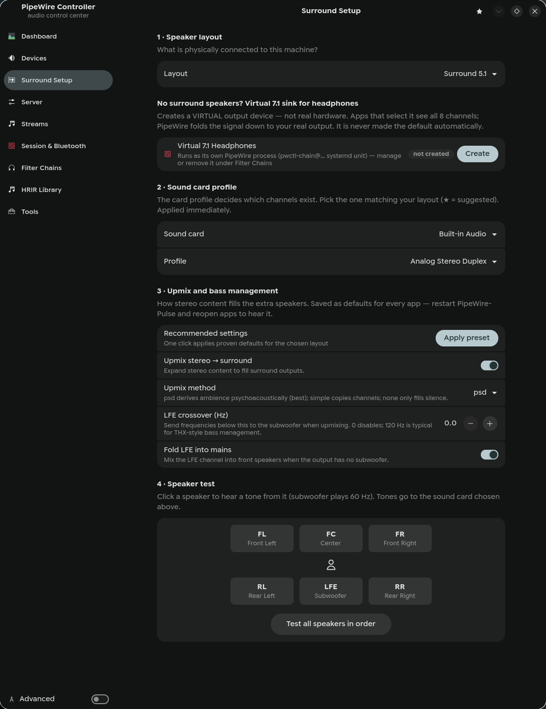

<h1 align="center">PipeWire Controller</h1>

<p align="center">
  <b>The audio control center for PipeWire.</b><br>
  Mix, route, process and tune all of your audio in one native app, without hand-editing a config file.
</p>

<p align="center">
  <a href="#install">Install</a> ·
  <a href="FEATURES.md">Features</a> ·
  <a href="screenshots/">Screenshots</a> ·
  <a href="CHANGELOG.md">Changelog</a> ·
  <a href="https://github.com/knightinfected/PipeWireController/discussions">Discussions</a> ·
  <a href="CONTRIBUTING.md">Contributing</a> ·
  <a href="#support">Support</a>
</p>

<p align="center">
  <a href="https://aur.archlinux.org/packages/pipewire-control-center"></a>
  <a href="https://github.com/knightinfected/PipeWireController/releases/latest"></a>
  <a href="LICENSE"></a>
</p>

<p align="center">
  
</p>

## What do you want to do?

| I want to… | Go to |
|---|---|
| turn one app down, or move it to another device while it plays | **Dashboard** → *Mixer* |
| keep the devices I use most one glance away | **Dashboard** → *Favorites*: pin any output, input or virtual device |
| play on two devices at once | **Virtual Devices** → *Combined output* |
| EQ my headphones with an AutoEQ profile | **Equalizer**: import the `ParametricEq.txt`, or drag it in |
| stop my mic picking up echo and room noise | **Equalizer** → *Microphone cleanup*, then pick the clean mic as your input |
| hear 7.1 surround on headphones | **Surround Setup** → *Virtual 7.1 Headphones* |
| set up real 5.1 or 7.1 speakers | **Surround Setup**: a wizard with a test tone for each speaker |
| get better Bluetooth audio | **Session & Bluetooth**: SBC-XQ, mSBC, and a codec per device |
| stop the pop or cut-off at the start of sounds | **Session & Bluetooth** → never suspend devices |
| work out why the audio crackles | **Monitor**: dropouts, DSP load and a live `pw-top` |
| put every setting back the way it was | **Tools** → *Reset all overrides* |

That's the everyday half. **[All features](FEATURES.md)** goes from here to
the advanced end: signal paths, filter chains, channel maps, per-app rules and
the server clock.

## A look inside

<table>
  <tr>
    <td width="33%" valign="top">
      <picture>
        <source media="(prefers-color-scheme: dark)" srcset="https://raw.githubusercontent.com/knightinfected/PipeWireController/main/screenshots/signal-paths-board.png">
        
      </picture>
      <b>Signal Paths</b><br>Draw where your audio goes: sources on the left, mixes on the right, effects on each. Start from 26 templates.
    </td>
    <td width="33%" valign="top">
      
      <b>Mixer</b><br>Every app and device, with live meters. Move a stream to another device while it plays.
    </td>
    <td width="33%" valign="top">
      
      <b>Equalizer</b><br>Parametric EQ with AutoEQ import and live A/B, plus echo and noise removal for your mic.
    </td>
  </tr>
  <tr>
    <td valign="top">
      
      <b>Patchbay</b><br>The live graph of your whole session. Drag a port onto another to connect, and save the result as a snapshot.
    </td>
    <td valign="top">
      
      <b>Virtual devices</b><br>Null sinks, virtual mics, one output that plays on several cards, buses, and per-channel maps.
    </td>
    <td valign="top">
      
      <b>Surround</b><br>A wizard for real 5.1 and 7.1 speakers, and HRIR virtual surround for headphones.
    </td>
  </tr>
</table>

**Also:** server clock and quantum, stream processing, per-app routing rules,
LADSPA/LV2 effect racks, filter chains, device presets and a live performance
monitor. **[All features](FEATURES.md)** · **[Every screenshot](screenshots/)**

## Install

<details open>
<summary><b>Arch, CachyOS, EndeavourOS, Manjaro</b> (AUR)</summary>

```bash
paru -S pipewire-control-center   # or: yay -S pipewire-control-center
```
</details>

<details>
<summary><b>Debian 13+, Ubuntu 26.04 LTS+</b> (.deb)</summary>

Debian 12, Ubuntu 24.04 and Linux Mint 22 are too old, and apt will refuse the
package. To check yours first, run `apt-cache policy gir1.2-adw-1`: the
*Candidate* line needs to show 1.7 or newer.

Download the `.deb` from the [latest release](https://github.com/knightinfected/PipeWireController/releases/latest),
then, in the folder you saved it to:

```bash
sudo apt install ./pipewire-control-center_0.6.1_all.deb
```

The `./` matters. It doesn't update itself, so install the next release's
`.deb` the same way. If you ran it from a checkout before, remove the old menu
entry first:

```bash
rm -f ~/.local/bin/pipewire-control-center ~/.local/bin/pwcc \
    ~/.local/share/applications/io.github.knightinfected.PipeWireControlCenter.desktop
```
</details>

<details>
<summary><b>Fedora, and running from source anywhere</b></summary>

Install the dependencies:

```bash
# Fedora
sudo dnf install pipewire pipewire-utils wireplumber pipewire-pulseaudio \
    pulseaudio-utils gtk4 libadwaita gobject-introspection python3-gobject \
    python3-numpy python3-soundfile
# Debian / Ubuntu (Ubuntu: add libspa-0.2-modules-extra for LV2 and SOFA)
sudo apt install pipewire wireplumber pipewire-pulse pulseaudio-utils \
    gir1.2-gtk-4.0 gir1.2-adw-1 python3-gi python3-gi-cairo python3-numpy \
    python3-soundfile
# Arch
sudo pacman -S --needed pipewire wireplumber pipewire-pulse gtk4 libadwaita \
    python-gobject python-cairo python-numpy python-soundfile
```

Elsewhere you need GTK 4, libadwaita, PyGObject with its cairo support
(`python3-gobject-cairo` on openSUSE), numpy, soundfile, and `pactl` for
switching Bluetooth codecs (`pulseaudio-utils`). Then:

```bash
git clone https://github.com/knightinfected/PipeWireController.git
cd PipeWireController && ./pipewire-control-center
```

For a `pwcc` command and an app-menu entry:

```bash
mkdir -p ~/.local/bin ~/.local/share/applications
ln -sf "$PWD/pipewire-control-center" ~/.local/bin/
ln -sf "$PWD/pipewire-control-center" ~/.local/bin/pwcc
sed "s|^Exec=.*|Exec=$HOME/.local/bin/pipewire-control-center|" \
    io.github.knightinfected.PipeWireControlCenter.desktop \
    > ~/.local/share/applications/io.github.knightinfected.PipeWireControlCenter.desktop
```

If a new terminal can't find `pwcc`, log out and back in once.

Optional extras: `noise-suppression-for-voice` (the RNNoise mic template),
`lsp-plugins-ladspa` (more LADSPA plugins), and PipeWire built with libmysofa
(the SOFA surround templates).
</details>

### Requirements

PipeWire 1.0+, WirePlumber 0.5+ and **libadwaita 1.7+**, which rules out
Debian 12, Ubuntu 24.04 and Linux Mint 22 (built on Ubuntu 24.04). Python
3.10+, and no build step.

## Questions

**Will it mess up my config?**
No. It never edits the files your distro ships. Its changes go into files of
its own, listed [below](#where-things-are-written). **Tools** → *Reset all
overrides* removes every setting it wrote, and anything you built, like a
chain or a virtual device, comes off its own page.

**Do I need to restart anything?**
Some changes apply instantly. When one needs a restart, a banner names the
service and restarts it for you. Filter chains, virtual devices and
equalizers each run as their own process, so changing one never interrupts
the rest of your audio.

**Something's broken.**
Please [open an issue](https://github.com/knightinfected/PipeWireController/issues).
I use this daily, which means I mostly find the bugs I happen to walk into,
and every PipeWire setup is different. Even a one-line report helps more than
you'd think.

## Where things are written

Uninstalling the package leaves your settings alone. To remove those too,
these are the only places the app writes:

| What | Where |
|---|---|
| Settings drop-ins | `~/.config/pipewire/{pipewire,client,pipewire-pulse}.conf.d/99-pipewire-controller.conf` and `~/.config/wireplumber/wireplumber.conf.d/99-pipewire-controller.conf` |
| Everything you build | `~/.config/pipewire-controller/`: chains, signal paths, equalizers, virtual devices, snapshots, HRIRs, rules, preferences |
| The runner unit | `~/.config/systemd/user/pwctl-chain@.service`, its links in `pipewire.service.wants/`, and any `pwctl-chain@*.service.d/` folders |
| The app-menu entry, if you made one from a checkout | `~/.local/share/applications/io.github.knightinfected.PipeWireControlCenter.desktop` |

There's one exception. **Import existing devices** on the Virtual Devices
page moves the drop-in it adopts into an `inactive/` folder next to it, so
PipeWire doesn't load it twice. Move the file back to undo that. Importing a
filter chain copies it and leaves your file where it was.

The unrelated `pipewire-controller` app from PyPI also keeps a `settings.json`
in `~/.config/pipewire-controller/`. If you use both, delete only what's
listed above.

## Support

<a href="https://github.com/sponsors/knightinfected"></a>
<a href="https://paypal.me/hmzknight"></a>

Any support lets me spend more time on this. If you can't, feedback and bug
reports help just as much. It's optional, always: the app is GPL-3.0 and
nothing is ever locked behind a donation.

Want to help with code? Read [CONTRIBUTING.md](CONTRIBUTING.md) first.

<details>
<summary><b>If you like tinkering like me…</b></summary>

…here are some cool GitHubs to visit for sound tools:

- [JDSP4Linux](https://github.com/Audio4Linux/JDSP4Linux): JamesDSP audio
  effects processor for PipeWire/PulseAudio
- [EasyEffects](https://github.com/wwmm/easyeffects): the classic effects
  rack for PipeWire
- [coppwr](https://github.com/dimtpap/coppwr): low-level PipeWire graph
  inspector and patchbay
- [polybar-pulseaudio-control](https://github.com/marioortizmanero/polybar-pulseaudio-control):
  volume/sink switcher module for Polybar
- [virtual-surround-manager](https://github.com/Berny23/virtual-surround-manager):
  HRIR-based virtual surround setup tool for Windows and Linux

…and some goated repos for presets, HRIRs, and DDCs:

- [M0Rf30/easyeffects-presets](https://github.com/M0Rf30/easyeffects-presets):
  easily the best EasyEffects preset collection
- [HRIR database](https://airtable.com/appayGNkn3nSuXkaz/shruimhjdSakUPg2m/tbloLjoZKWJDnLtTc):
  big searchable HRIR database (Airtable)
- [GentleDynamics](https://github.com/droidwayin/GentleDynamics): the best
  presets if you want to add your own HRIRs
- [JackHack96/EasyEffects-Presets](https://github.com/JackHack96/EasyEffects-Presets):
  the default recommendation for EasyEffects presets
- [JamesDSP DDC library](https://media.aicp-rom.com/JamesDSP/DDC/):
  headphone DDC correction files
- [Linux_Audio](https://github.com/BayouGuru67/Linux_Audio): hard stuff for
  large speaker systems
</details>

---

<sub>Licensed [GPL-3.0-or-later](LICENSE). The icons in `pwctl/icons/` are from the GNOME
[icon-development-kit](https://gitlab.gnome.org/Teams/Design/icon-development-kit), under CC0 1.0.
Thanks to Wim Taymans, creator of PipeWire, for reviewing the Server page.</sub>
